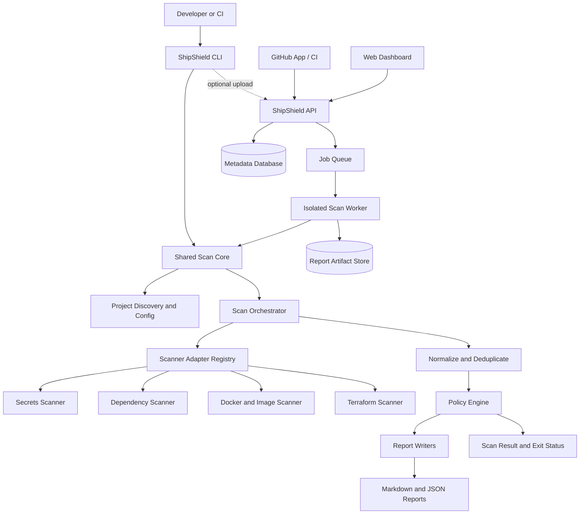
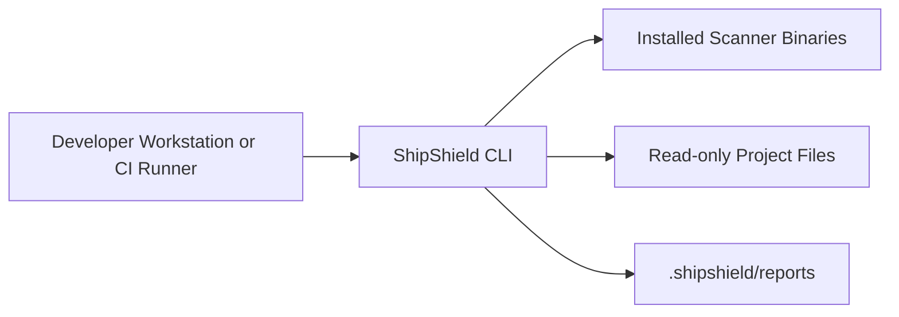
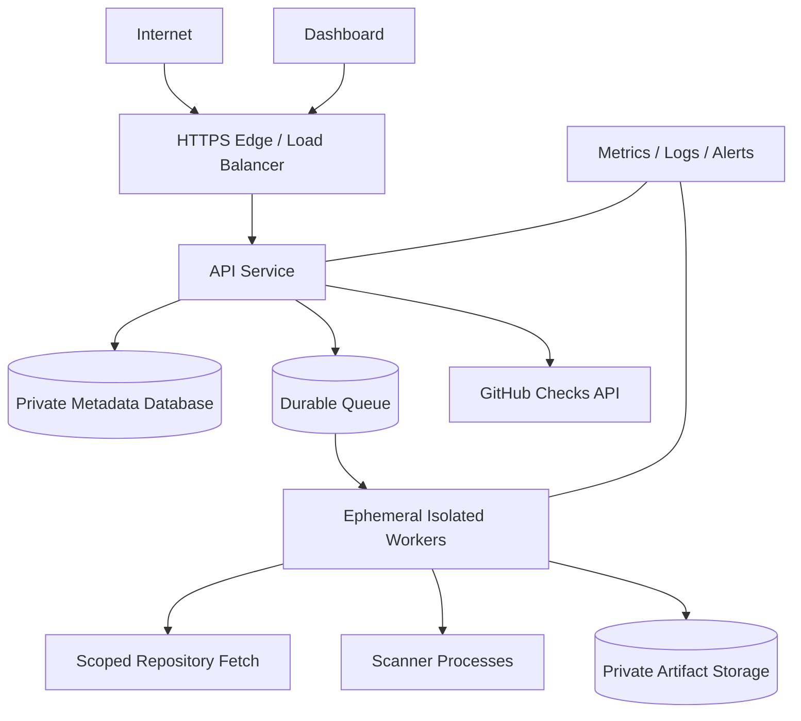

# ShipShield — System Design and Architecture

**Document:** 03 — System Design and Architecture  
**Status:** Proposed architecture  
**Version:** 1.0  
**Last updated:** 2026-10-24  
**Audience:** Product engineers, backend engineers, CLI engineers, DevOps engineers, security reviewers

> **Implementation disclaimer:** This document defines a production-oriented target architecture. It does not imply that the described components are already implemented. Treat the design as a baseline for implementation and validate decisions with prototypes, tests, and architecture decision records (ADRs).

---

## 1. Purpose

This document describes the target architecture for ShipShield, a security gate that orchestrates established scanners for secrets, dependency vulnerabilities, Docker/container risks, and Terraform misconfigurations.

It defines:

- System boundaries and responsibilities.
- Component architecture and runtime data flows.
- CLI, API, worker, scanner adapter, policy, report, and persistence responsibilities.
- Core data contracts and trust boundaries.
- Reliability, scalability, security, observability, and deployment requirements.
- UML-style component, sequence, deployment, and domain diagrams.
- Architectural decisions that must be finalized before implementation.

The CLI is the primary MVP interface. Hosted API, GitHub App, dashboard, and persistent team history are optional later capabilities that should reuse the same core contracts.

## 2. Architectural goals

1. **Secure by default:** scanning untrusted repositories must not require arbitrary code execution.
2. **Correct scan status:** incomplete scans must never be reported as clean.
3. **Consistent contracts:** every scanner adapter maps output into one versioned finding model.
4. **Separation of concerns:** scanner invocation, normalization, policy evaluation, reporting, and transport are independently testable.
5. **Local-first MVP:** local scanning works without a hosted account.
6. **Explicit remediation:** scans are read-only apart from designated ShipShield metadata and reports; source changes require a separate approved workflow.
7. **CI reliability:** stable exit statuses, deterministic policy behavior, bounded resource use, and useful diagnostics.
8. **Least privilege:** each process or service receives only the access it requires.
9. **Incremental evolution:** hosted capabilities can be added without rewriting the core scan engine.
10. **Operational visibility:** failures, timeouts, skipped scanners, and policy decisions are observable without exposing secrets.

## 3. Scope and system boundary

### In scope

- CLI commands and project discovery.
- Configuration parsing and validation.
- Scanner orchestration and scanner adapters.
- Finding normalization, fingerprinting, deduplication, and policy evaluation.
- Markdown and JSON report generation.
- Safe remediation workflow design.
- Optional API, isolated workers, database, GitHub App, and web dashboard.
- CI/CD, deployment, monitoring, and security controls for the product itself.

### Out of scope for the MVP

- Replacing specialist scanners.
- Guaranteeing the absence of vulnerabilities.
- Automatically executing arbitrary repository scripts or builds.
- Automatically applying all fixes.
- Hosted multi-tenant dashboard and scan-history services.
- Running deployment changes against customer production infrastructure.

## 4. High-level architecture

The architecture is divided into a **shared core**, **interfaces**, and **optional hosted services**.



**Interpretation**

- The shared scan core should be reusable by the CLI and worker without depending on HTTP, a database, or the UI.
- The CLI writes local reports directly.
- The hosted architecture is optional and should be introduced only when remote scans, collaboration, or centralized history are required.
- Hosted scan workers are a separate trust boundary. They must not run with unrestricted access to the API's database credentials or control plane.

## 5. Logical components and responsibilities

| Component | Responsibility | Must not do |
|---|---|---|
| CLI command layer | Parse arguments, display progress, invoke use cases, map results to exit codes | Implement scanner-specific parsing or policy logic |
| Project discovery | Find repository root, identify supported manifests, resolve safe paths | Execute project scripts |
| Configuration service | Load, validate, default, and version project settings | Silently ignore invalid security settings |
| Scan orchestrator | Plan checks, enforce concurrency/time/resource limits, aggregate statuses | Treat a failed scanner as zero findings |
| Scanner adapter registry | Select adapters and validate their capabilities | Expose vendor-specific output as the public finding contract |
| Scanner adapter | Build safe command arguments, execute a supported tool, parse its output | Invoke shell commands with interpolated untrusted strings |
| Process runner | Start bounded child processes, capture output, enforce timeout and termination | Inherit unnecessary environment variables or permissions |
| Finding normalizer | Convert scanner output into the common schema and map severity | Discard source provenance or fabricate evidence |
| Fingerprinting and deduplication | Identify equivalent findings within and across scans | Merge distinct resources solely because their messages match |
| Policy engine | Apply configured thresholds and exceptions deterministically | Change the original scanner severity |
| Report writer | Serialize schema-validated Markdown/JSON and redact sensitive evidence | Write outside the configured output boundary |
| Remediation planner | Determine whether a supported fix can be proposed safely | Modify files during a scan or apply a fix implicitly |
| Remediation executor | Apply approved changes with precondition checks and a reviewable diff | Overwrite unrelated user changes |
| API layer (later) | Authentication, authorization, request validation, service orchestration | Run untrusted scanner processes in the API process |
| Job queue (later) | Durable scheduling, retries, backpressure, deduplication | Treat retry as permission to run an unsafe operation indefinitely |
| Worker (later) | Execute scan jobs in a sandbox and publish results | Have broad access to control-plane secrets or other tenants' data |
| Persistence layer (later) | Store project metadata, scan status, policy versions, finding lifecycle | Store raw secrets or unrestricted scanner output by default |
| Artifact store (later) | Store reports with access control, encryption, retention, and integrity checks | Allow public access to private scan reports |
| GitHub integration (later) | Validate webhooks, schedule scans, publish check results | Expose raw secret values in comments or logs |
| Dashboard (later) | Present projects, scan history, policies, and findings | Enforce authorization only in the browser |

## 6. Recommended repository layout

Use a monorepo only if shared contracts and coordinated releases justify it. A suggested layout is:

```text
shipshield/
├── README.md
├── CONTRIBUTING.md
├── CHANGELOG.md
├── LICENSE
├── .env.example
├── .gitignore
├── package.json
├── package-lock.json
├── apps/
│   ├── cli/
│   │   ├── src/
│   │   │   ├── commands/
│   │   │   ├── output/
│   │   │   └── main.js
│   │   └── test/
│   ├── api/                    # Later phase
│   │   ├── src/
│   │   │   ├── routes/
│   │   │   ├── middleware/
│   │   │   └── main.js
│   │   └── test/
│   ├── worker/                 # Later phase
│   │   ├── src/
│   │   └── test/
│   └── web/                    # Later phase
│       ├── src/
│       └── test/
├── packages/
│   ├── scan-core/
│   │   ├── src/
│   │   │   ├── discovery/
│   │   │   ├── config/
│   │   │   ├── orchestration/
│   │   │   ├── findings/
│   │   │   ├── policy/
│   │   │   ├── reports/
│   │   │   └── remediation/
│   │   └── test/
│   ├── scanner-adapters/
│   │   ├── src/
│   │   │   ├── secrets/
│   │   │   ├── dependencies/
│   │   │   ├── containers/
│   │   │   └── terraform/
│   │   └── test/
│   ├── contracts/
│   │   ├── finding.schema.json
│   │   ├── scan-report.schema.json
│   │   └── api/
│   └── shared/
│       └── src/
├── fixtures/
│   ├── clean-project/
│   ├── secrets-findings/
│   ├── vulnerable-dependencies/
│   ├── docker-misconfigurations/
│   └── terraform-misconfigurations/
├── docs/
│   ├── product/
│   ├── architecture/
│   │   └── decisions/
│   ├── cli/
│   ├── scanning/
│   ├── security/
│   ├── testing/
│   ├── devops/
│   └── project/
└── infra/                      # Later phase; deployment-specific
    ├── terraform/
    └── docker/
```

This is a target structure, not a requirement to create empty packages immediately. For the MVP, begin with `apps/cli`, `packages/scan-core`, `packages/scanner-adapters`, `packages/contracts`, and test fixtures. Add hosted apps only when their release is scheduled.

## 7. Runtime flows

### 7.1 Local scan flow

1. Parse the command and validate arguments.
2. Resolve the project root and output directory.
3. Load and validate configuration.
4. Discover relevant files without executing repository-controlled scripts.
5. Build a scan plan with enabled scanners and their prerequisites.
6. Execute scanner adapters under time, output, and concurrency limits.
7. Parse scanner output and validate it against adapter-specific expectations.
8. Normalize findings and retain scanner provenance.
9. Deduplicate findings and calculate stable fingerprints where possible.
10. Evaluate policies and compute overall scan status.
11. Redact sensitive evidence before generating reports.
12. Write reports using safe path handling and atomic file replacement where practical.
13. Print a summary and return the documented exit code.

**Invariant:** If a required check fails, times out, or is unavailable, the overall result is `incomplete` (or another explicitly documented failure state), not `clean`.

### 7.2 Hosted scan flow (later phase)

1. GitHub sends an event to the webhook endpoint.
2. API validates the signature, event type, repository installation, and request shape.
3. API checks authorization and policy configuration.
4. API creates an idempotent scan job and enqueues it.
5. A worker claims the job and prepares an isolated workspace.
6. The worker fetches only the permitted repository revision using short-lived, scoped credentials.
7. The worker executes the shared scan core in a restricted environment.
8. The worker uploads a validated, redacted report to private storage.
9. API records the scan status and report reference.
10. GitHub integration publishes a check result containing a safe summary.
11. Temporary credentials and workspace data are revoked or destroyed.

Do not give workers general-purpose cloud credentials or direct database access unless there is a documented, narrowly scoped reason. Prefer a control-plane API or narrowly scoped job credentials.

### 7.3 Remediation flow (later phase)

1. User selects one or more findings with a supported fix.
2. Remediation planner validates finding IDs and checks current file state.
3. Planner generates a proposed patch without applying it.
4. CLI displays a diff and any relevant warnings.
5. User explicitly approves application.
6. Executor revalidates preconditions to avoid stale edits.
7. Executor applies the minimal patch and reports each file operation.
8. Verification scan runs again.
9. Report marks findings resolved only when the new scan supports that conclusion.

A remediation action must not claim success when patch application or verification fails.

## 8. Core contracts and domain model

### 8.1 Main domain entities

| Entity | Purpose | Key relationships |
|---|---|---|
| Project | A local repository or hosted repository identity | Has configurations and scans |
| ProjectConfig | Versioned scanner, policy, and report settings | Belongs to a project or local workspace |
| Scan | One execution against a project revision | Has scanner runs, findings, and a policy result |
| ScannerRun | Execution state for one scanner | Belongs to a scan |
| Finding | A normalized security or configuration issue | Produced by a scanner run; may recur across scans |
| FindingOccurrence | Finding at a specific revision and location | Connects finding identity to a scan |
| Policy | Rules that determine whether a scan passes | Applied to a scan |
| PolicyException | Reviewed exception for a rule/finding scope | Has reason, scope, author, and optional expiry |
| ReportArtifact | Generated report metadata and storage reference | Belongs to a scan |
| RemediationPlan | Proposed change for selected findings | References findings and affected files |
| AuditEvent | Security-relevant action record | References actor, project, and action |

For local-only operation, these entities can be represented in JSON reports and local files. A database is not required for the MVP.

### 8.2 Finding lifecycle

A finding's status and a scan's outcome are separate concepts.

- **Finding lifecycle:** open, resolved, accepted-risk, or suppressed, where supported.
- **Scanner execution status:** succeeded, failed, timed-out, skipped, or unsupported.
- **Scan outcome:** passed, policy-failed, incomplete, configuration-error, or internal-error.

Do not use a single boolean to represent all three concepts.

### 8.3 Illustrative finding object

The following is an example of the intended data shape, not a final schema:

```json
{
  "schema_version": "1.0",
  "finding_id": "finding_example",
  "fingerprint": "sha256:example-fingerprint",
  "scanner": {
    "name": "example-scanner",
    "version": "1.2.3"
  },
  "rule_id": "EXAMPLE-001",
  "category": "terraform",
  "title": "Example infrastructure misconfiguration",
  "description": "Illustrative description only.",
  "severity_original": "HIGH",
  "severity_normalized": "high",
  "location": {
    "path": "infra/main.tf",
    "start_line": 12,
    "end_line": 18
  },
  "evidence": {
    "redacted": true,
    "summary": "Sensitive values omitted."
  },
  "remediation": {
    "available": false,
    "guidance": "Review the resource configuration."
  }
}
```

The final schema must define required and optional fields, enums, path normalization, timestamp formats, evidence limits, and schema-version compatibility. Avoid including raw secret values in any finding field.

## 9. Scanner adapter design

Each scanner integration must implement a common adapter interface. The exact programming-language types should be defined in the implementation.

Conceptually:

```text
ScannerAdapter
  id()
  version()
  capabilities()
  checkAvailability(context)
  buildInvocation(scanRequest)
  parseOutput(stdout, stderr, exitStatus)
  normalize(rawFinding)
```

### Adapter requirements

- Use argument arrays rather than shell interpolation.
- Validate all file paths and arguments before invocation.
- Pass a minimal environment allowlist instead of inheriting the full environment.
- Apply timeouts, output-size limits, and termination handling.
- Capture tool version and execution status.
- Treat stdout/stderr as untrusted data.
- Parse only documented output formats and reject malformed results safely.
- Redact sensitive content before logging or persisting.
- Preserve source rule IDs, original severity, and tool provenance.
- Provide fixtures for valid output, malformed output, empty output, timeout, and non-zero exit.
- Never interpret a scanner's non-zero exit status as “no findings” without understanding that tool's documented semantics.

### Initial adapter categories

| Category | Scope | Notes |
|---|---|---|
| Secrets | Tracked and supported filesystem content | Prevent raw credential disclosure; define exclusions carefully |
| Dependencies | Supported manifests and lockfiles | Document ecosystem coverage and advisory-data freshness |
| Docker/container | Dockerfiles and optionally images | Image scanning may require image access and additional isolation |
| Terraform/IaC | Terraform configuration and supported plan inputs | Avoid applying infrastructure changes; scanning is read-only |

Select exact tools only after comparing license, maintenance, output stability, platform support, resource requirements, and severity semantics.

## 10. Policy engine

The policy engine consumes normalized findings, scanner execution statuses, configuration, and optional reviewed exceptions. It returns a structured decision rather than directly printing output.

### Required behavior

- Keep original severity separate from normalized severity.
- Use a documented severity mapping.
- Evaluate thresholds deterministically.
- Define behavior for unknown severities.
- Define whether skipped, unsupported, or failed scanners block the result.
- Apply exceptions only when their scope and expiry validate.
- Include a reason for each pass/fail/incomplete decision.
- Include the policy/configuration version in scan metadata.
- Keep policy evaluation pure and independently unit-testable where practical.

### Suggested result model

```json
{
  "outcome": "policy_failed",
  "policy_version": "1",
  "blocking_findings": 2,
  "reasons": [
    "Two findings meet or exceed the configured blocking threshold."
  ],
  "incomplete_checks": []
}
```

This is illustrative. Exact fields and outcome values belong in the finding/report contract and CLI specification.

## 11. CLI and exit-status boundary

The CLI is responsible for user interaction and process exit codes; the scan core should return a structured result.

Proposed outcome categories:

| Outcome | Meaning |
|---|---|
| `passed` | Required checks completed and policy is satisfied |
| `policy_failed` | Checks completed, but one or more policy rules block success |
| `incomplete` | One or more required checks failed, timed out, or could not run |
| `configuration_error` | Configuration or command arguments are invalid |
| `internal_error` | Unexpected ShipShield failure |

The numeric exit codes and precedence rules must be defined in `docs/cli/specification.md`. If both policy failure and an incomplete required scan occur, the documented behavior must make the incomplete state visible and must not return a success code.

## 12. API architecture (later phase)

The API should be a thin authenticated control plane. It must not run arbitrary scanners in request handlers.

### Suggested logical modules

- Authentication and session/token validation.
- Organizations, users, and repository installations.
- Projects and repository metadata.
- Scan requests and scan status.
- Policy and exception management.
- Report metadata and authorized artifact retrieval.
- GitHub webhook handling and check publication.
- Audit events and administrative actions.
- Health, readiness, and operational metrics.

### API rules

- Validate request schemas at the boundary.
- Authenticate and authorize every protected operation.
- Enforce project/tenant ownership server-side.
- Apply rate limits and request-size limits.
- Use idempotency for event-triggered scan creation.
- Return stable error formats without stack traces or secret material.
- Avoid placing report content or credentials in URLs.
- Use pagination for list endpoints.
- Version public contracts and document them with OpenAPI.
- Use database transactions for multi-record state transitions where appropriate.

## 13. Persistence and report storage (later phase)

### Data separation

Keep control-plane metadata separate from potentially sensitive report artifacts.

**Metadata database may store:**
- User/organization/project identifiers.
- Scan status and timestamps.
- Scanner execution metadata.
- Policy decisions and versions.
- Finding identities and lifecycle state.
- Artifact references and retention metadata.
- Audit events.

**Private artifact storage may store:**
- Redacted Markdown and JSON reports.
- Optional supporting artifacts only when explicitly enabled and justified.

Do not store raw scanner output or secret values by default.

### Storage requirements

- Encryption in transit and at rest.
- Strict authorization at project and organization boundaries.
- Private buckets/containers with public access blocked.
- Short-lived signed links, if signed links are used.
- Configurable retention and deletion.
- Backup and recovery procedures for metadata.
- Integrity and access logging for sensitive artifacts.
- Idempotent writes and safe retry behavior.

The exact database, object store, queue, and retention periods are deployment decisions, not fixed assumptions in this design.

## 14. Security architecture and threat boundaries

### Assets to protect

- Source code and repository metadata.
- Detected credentials and private keys.
- Scanner output and finding evidence.
- GitHub App private key and webhook secret.
- API credentials, session tokens, and job tokens.
- Stored reports, policies, exceptions, and audit history.
- Integrity of scan results and release artifacts.

### Trust boundaries

1. Developer/CI environment to local CLI.
2. Untrusted repository files to scanner adapters.
3. Scanner subprocesses to the parent process.
4. GitHub webhook ingress to API control plane.
5. API control plane to job queue and scan workers.
6. Scan worker to external repository and advisory services.
7. Worker to report artifact storage.
8. User/tenant boundary within the hosted service.

### Mandatory controls

- Do not execute repository scripts or package lifecycle hooks by default.
- Use isolated, short-lived workers for hosted scanning of untrusted repositories.
- Do not mount the Docker socket into untrusted scan containers.
- Use non-root execution, read-only filesystems where practical, seccomp/AppArmor or equivalent controls, and resource quotas.
- Disable network access by default in scan sandboxes; allowlist only required endpoints when possible.
- Never expose control-plane credentials to scan workers.
- Use short-lived, repository-scoped credentials where repository access is needed.
- Verify GitHub webhook signatures using constant-time comparison and reject invalid events.
- Redact secret evidence before logs, reports, and comments are persisted.
- Protect against path traversal, symlink escapes, zip bombs, oversized files, and hostile scanner output.
- Limit concurrency, wall-clock duration, memory, CPU, process count, and output size.
- Apply authorization on the server for every project/report operation.
- Log security-relevant events without sensitive values.

A container is a useful isolation layer but is not a complete security boundary on its own. The hosted worker threat model must be reviewed before public multi-tenant use.

## 15. Reliability and failure handling

### Failure cases to design and test

- Scanner binary missing or version unsupported.
- Scanner exits non-zero with valid findings.
- Scanner crashes, hangs, or exceeds resource limits.
- Scanner returns malformed or unexpectedly large output.
- Project configuration is invalid.
- Report directory is not writable or resolves outside the project boundary.
- Disk becomes full during report generation.
- API, queue, database, or artifact storage becomes unavailable.
- GitHub sends duplicate or out-of-order webhook events.
- Worker crashes or loses its lease during a scan.
- A report upload succeeds but metadata update fails, or vice versa.

### Reliability requirements

- Represent scanner execution status separately from findings.
- Use bounded retries only for transient, idempotent operations.
- Make scan-job creation idempotent for duplicate webhook deliveries.
- Use atomic report writes where practical.
- Clean up temporary workspaces and credentials after success or failure.
- Track job leases and detect abandoned work.
- Avoid retrying deterministic configuration or parsing errors indefinitely.
- Preserve enough sanitized diagnostics to explain a failure.
- Ensure recovery does not mark a failed scan as successful.

## 16. Performance and scaling

The MVP should optimize for predictable behavior rather than premature distributed complexity.

### Local CLI

- Run independent scanners concurrently with a configurable concurrency cap.
- Keep per-scanner timeouts and a total scan deadline.
- Avoid scanning the same file repeatedly when the scanner does not require it.
- Report elapsed time and slow or failed checks.
- Establish performance baselines on small, medium, and large fixture repositories.

### Hosted service

- Keep API request handlers short and enqueue scans asynchronously.
- Scale workers independently from the API.
- Apply per-organization and global concurrency limits.
- Use queue backpressure and fair scheduling.
- Set worker resource limits based on repository size and scanner profile.
- Cache only data with clear invalidation and tenant-isolation rules.
- Monitor queue age, failure rates, scan duration, and resource use.

Do not publish scan-time guarantees until measured against defined repository profiles and supported scanner configurations.

## 17. Observability

### Structured events

Record events such as:

- `scan.started`
- `scanner.started`
- `scanner.completed`
- `scanner.failed`
- `policy.evaluated`
- `report.written`
- `remediation.previewed`
- `remediation.applied`
- `scan.completed`

Events should include a correlation ID, scan ID where available, scanner ID, duration, and status. They must not include raw secret values, authorization headers, private keys, or unrestricted source snippets.

### Metrics for hosted deployments

- Scan count by outcome.
- Scanner success/failure/timeout rate.
- Scan duration by scanner and repository-size bucket.
- Queue depth and oldest job age.
- Worker CPU, memory, and termination rate.
- Report storage failures.
- API latency and error rate.
- GitHub webhook validation failures and duplicate events.
- Redaction and policy-evaluation errors.

### Alerts

Alert on sustained increases in incomplete scans, worker crashes, queue backlog, artifact storage failures, elevated API errors, and suspected credential exposure. Alert thresholds should be tuned from observed baselines.

## 18. Deployment architecture

### Local MVP



Local scanning should not require a database, hosted account, or network connection except where a configured scanner needs vulnerability data or an explicitly enabled integration.

### Hosted production (later phase)



### Environment separation

- **Development:** local services and test repositories; fake credentials only.
- **Test/CI:** deterministic fixtures, pinned tools, ephemeral resources.
- **Staging:** production-like permissions and deployment topology using test repositories.
- **Production:** least privilege, protected secrets, monitored services, backups, retention, and documented incident response.

Use separate credentials and storage boundaries across environments. Never use production secrets in local test fixtures.

## 19. Testing strategy

Testing must cover contracts and failure modes, not only the successful scan path.

- **Unit tests:** config validation, severity mapping, fingerprints, deduplication, policy decisions, redaction, path handling.
- **Contract tests:** finding schema, report schema, adapter output formats, API OpenAPI contract.
- **Adapter tests:** missing binary, supported version, malformed output, timeout, non-zero exit, large output.
- **Integration tests:** known fixture repositories and expected normalized findings.
- **CLI tests:** root discovery, nested directories, report output, exit codes, read-only scan behavior.
- **Remediation tests:** dry-run, patch correctness, changed-file detection, explicit approval, partial failure, verification.
- **Security tests:** path traversal, symlinks, malicious filenames, hostile output, secret redaction, process environment leakage, resource exhaustion.
- **API tests:** authentication, authorization, tenant isolation, validation, rate limits, idempotency.
- **Worker tests:** sandbox configuration, cleanup, retry, lease expiry, no control-plane credentials.
- **End-to-end tests:** local CLI and CI workflow; hosted flow only when implemented.

Use fake secrets in fixtures. Avoid putting real credentials into test snapshots, logs, or issue reports.

## 20. Implementation sequence

### Phase 0 — Architecture contracts

- [ ] Confirm CLI language, packaging, and supported platforms.
- [ ] Write CLI specification and exit-code contract.
- [ ] Define finding and scan-report schemas.
- [ ] Select initial scanner tools after license and capability review.
- [ ] Complete threat model and remediation safety rules.
- [ ] Record key decisions as ADRs.

### Phase 1 — Local scan core

- [ ] Implement project discovery and configuration validation.
- [ ] Implement process runner with timeouts, bounded output, and environment allowlist.
- [ ] Implement scanner adapter interface and first adapters.
- [ ] Implement finding normalization, severity mapping, and deduplication.
- [ ] Implement policy evaluation and structured scan outcome.
- [ ] Implement Markdown and JSON report writers.
- [ ] Implement CLI commands and stable exit codes.
- [ ] Add fixture-driven unit, integration, and security tests.

### Phase 2 — Remediation

- [ ] Implement remediation plan and dry-run.
- [ ] Add explicit approval and diff output.
- [ ] Protect uncommitted user changes and enforce safe paths.
- [ ] Add post-fix verification and failure reporting.

### Phase 3 — GitHub and hosted scan service

- [ ] Implement authenticated API and OpenAPI contract.
- [ ] Implement webhook validation and idempotent scan creation.
- [ ] Add durable queue and isolated worker execution.
- [ ] Add private artifact storage and tenant authorization.
- [ ] Publish sanitized GitHub check results.
- [ ] Add metrics, alerts, backups, and operational runbooks.

### Phase 4 — Dashboard and team governance

- [ ] Add authenticated dashboard.
- [ ] Add project and scan-history views.
- [ ] Add policy and exception management with audit trail.
- [ ] Add retention controls and team administration.

## 21. Architecture decision records required

Create ADRs for decisions that are expensive to reverse.

- **ADR-001:** Monorepo versus multiple repositories.
- **ADR-002:** CLI language, runtime, and distribution method.
- **ADR-003:** Initial scanner selection and license compatibility.
- **ADR-004:** Finding schema and fingerprint strategy.
- **ADR-005:** Exit-code precedence for policy failure versus incomplete scan.
- **ADR-006:** Local report storage and default Git ignore behavior.
- **ADR-007:** Hosted worker isolation and repository-fetch credentials.
- **ADR-008:** Queue, database, and artifact storage choices.
- **ADR-009:** GitHub App permissions and webhook processing.
- **ADR-010:** Remediation scope, approval, and rollback model.

An ADR should record context, considered options, decision, consequences, security implications, and date. Avoid making a decision appear final until it has been reviewed.

## 22. Production readiness checklist

### Architecture and implementation

- [ ] Module boundaries and contracts are enforced by tests.
- [ ] Scanner adapters are isolated from CLI presentation and API transport.
- [ ] Scan, scanner-run, and finding statuses are distinct.
- [ ] Schemas are versioned and validated.
- [ ] CLI exit behavior is stable and documented.

### Security

- [ ] Threat model has been reviewed.
- [ ] Secrets are redacted before persistence.
- [ ] Repository scripts are not executed by default.
- [ ] Hosted workers are isolated and have no broad control-plane credentials.
- [ ] File and report paths are validated against traversal and symlink escapes.
- [ ] API authorization is enforced server-side.
- [ ] GitHub webhooks are signature-verified.
- [ ] Dependency and scanner update processes are documented.

### Reliability and operations

- [ ] Timeouts, output limits, and concurrency limits are enforced.
- [ ] Incomplete scans cannot pass required checks silently.
- [ ] Transient retries are bounded and idempotent.
- [ ] Logs and metrics exclude secret material.
- [ ] Backups, retention, recovery, and incident runbooks exist for hosted services.
- [ ] CI covers unit, integration, contract, and security tests.
- [ ] Release process and rollback strategy are documented.

### Product and documentation

- [ ] Supported operating systems, scanner versions, and file types are listed.
- [ ] Known limitations and false-positive handling are documented.
- [ ] Installation and upgrade paths are tested.
- [ ] Configuration and report schema compatibility is documented.
- [ ] User-facing behavior matches the implemented release.

---

## 23. Final architecture recommendation

Build ShipShield as a **local-first CLI backed by a reusable scan-core package and scanner-adapter layer**. Treat findings, scan status, policy results, and reports as explicit versioned contracts. Make the initial scan workflow read-only, bounded, and transparent about missing or failed checks. Add remediation only after the core scanner pipeline and safety tests are reliable.

Do not build the dashboard, distributed worker system, and multi-tenant persistence before the CLI demonstrates value. When hosted scanning is introduced, isolate untrusted scan workloads from the control plane and treat repository content and scanner output as hostile input.

The most important production requirement is not the number of scanners or features: **ShipShield must never confuse “the scan found no issues” with “the scan did not successfully run.”**

## Change history

| Version | Date | Change |
|---|---|---|
| 1.0 | 2026-10-24 | Initial proposed system design and architecture. |
