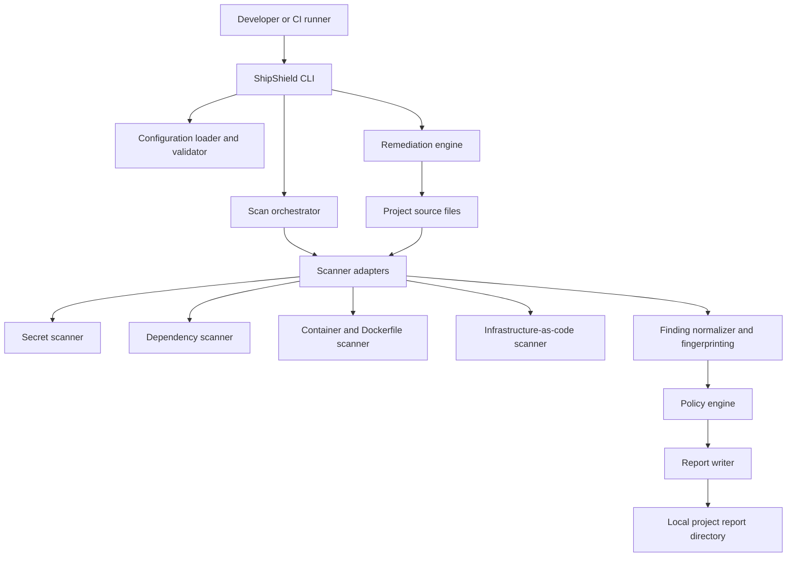

# 05 — ShipShield Security and Threat Model

**Document status:** Draft security baseline for implementation and review  
**Version:** 1.0  
**Product:** ShipShield  
**Audience:** Engineering, security, DevSecOps, product, QA, and maintainers  
**Normative language:** **MUST**, **MUST NOT**, **SHOULD**, **SHOULD NOT**, and **MAY** describe requirements.

> This is a target-state threat model, not a claim that ShipShield has implemented or independently validated every control. The threat model must be reviewed whenever the architecture, scanner set, data flow, or trust boundaries materially change.

## 1. Executive summary

ShipShield is a local-first security gate that orchestrates scanners for secrets, vulnerable dependencies, container/Dockerfile risks, and infrastructure-as-code misconfigurations. It normalizes findings, evaluates policy, writes reports, and may offer explicit remediation.

ShipShield processes potentially hostile repositories and scanner output. A repository may contain malicious filenames, symlinks, crafted manifests, oversized files, malformed configuration, fake scanner executables, prompt-injection text, or real credentials. Scanner engines and vulnerability databases are additional dependencies and trust boundaries. A future hosted service would introduce account, tenant, API, storage, and integration risks that are not present in the local-only MVP.

The primary security objective is to make security analysis safer and more reliable without turning ShipShield into a mechanism for executing untrusted project code or leaking the very secrets it discovers.

### 1.1 Security objectives

ShipShield MUST:

1. Protect user source code, credentials, scanner outputs, reports, and local configuration from unauthorized disclosure.
2. Avoid executing repository-controlled code during ordinary scans.
3. Prevent untrusted repository data from controlling shell commands, file paths, network destinations, or remediation behavior.
4. Preserve the integrity of findings, reports, policy decisions, and exit statuses.
5. Fail closed when required analysis cannot complete; never report a clean pass for an incomplete scan.
6. Make source modification explicit, reviewable, constrained, and recoverable.
7. Minimize permissions, network access, persistence, telemetry, and retention.
8. Clearly disclose the data sent to external scanner services, APIs, or future hosted components.
9. Provide reproducible diagnostics without printing raw secrets or sensitive environment data.
10. Support a defensible security review, incident response, and vulnerability disclosure process.

### 1.2 Out of scope for the local-first MVP

Unless separately designed and reviewed, the MVP does not:

- Guarantee that a repository is free from vulnerabilities.
- Guarantee that external scanner engines or vulnerability databases are correct.
- Safely execute arbitrary project builds, tests, package lifecycle scripts, Docker builds, Terraform plans, or deployment workflows.
- Automatically revoke or rotate leaked credentials.
- Provide multi-tenant hosted-service isolation.
- Guarantee remediation of every finding.
- Replace code review, software composition analysis governance, runtime monitoring, or a formal security program.
- Protect a workstation already compromised by an attacker with equivalent or higher privileges.

These limits MUST be visible in user-facing documentation and must not be obscured by a “secure” or “passed” label.

## 2. System under review

### 2.1 Current target architecture

The first release is a local CLI with a reusable scan core and adapters for established scanner engines.



The diagram represents intended logical boundaries. Actual process isolation depends on the chosen implementation language and scanner packaging. A module boundary alone is not a security sandbox.

### 2.2 Future architecture

A hosted API, web dashboard, GitHub App, remote workers, or organization policy service would add new trust boundaries. Those components require a separate threat-model review before release. This document includes future-facing controls in Section 14, but the local MVP must not imply that hosted controls already exist.

### 2.3 Assets

| ID | Asset | Security properties to preserve |
|---|---|---|
| A-01 | Source code and repository contents | Confidentiality, integrity |
| A-02 | Secrets in source, history, files, and environment | Confidentiality, limited exposure |
| A-03 | Scanner executables, versions, and databases | Integrity, provenance |
| A-04 | Findings, fingerprints, and evidence | Integrity, confidentiality |
| A-05 | Reports and scan history | Integrity, confidentiality, retention |
| A-06 | Configuration and policy | Integrity, provenance |
| A-07 | Remediation patches and changed files | Integrity, authorization |
| A-08 | CLI binary and update channel | Integrity, authenticity |
| A-09 | User credentials and future integration tokens | Confidentiality, least privilege |
| A-10 | CI identity and runner permissions | Least privilege, isolation |
| A-11 | Audit records and diagnostics | Integrity, redaction |
| A-12 | Network requests and remote content | Destination integrity, confidentiality |

### 2.4 Security boundaries

| Boundary | Untrusted input crossing it | Required controls |
|---|---|---|
| CLI arguments → command handlers | User input, CI variables | Typed parsing, validation, no shell interpolation |
| Repository → configuration parser | YAML/JSON and paths | Strict schema, size limits, no executable deserialization |
| Repository → scanner | Source files, manifests, filenames | Read-only scope, bounded resources, adapter validation |
| Scanner process → normalizer | stdout, stderr, result files, exit code | Schema validation, redaction, size limits, status validation |
| Findings → policy engine | Rule metadata and normalized fields | Typed domain objects, deterministic policy evaluation |
| Findings → terminal/reports | Secret-like evidence, paths, control characters | Redaction, output encoding, terminal-safe rendering |
| CLI → filesystem | Paths, symlinks, pre-existing files | Canonicalization, root containment, atomic writes |
| Remediation engine → source files | Patch, line ranges, stale state | Explicit approval, hash checks, bounded patch application |
| CLI → network | Advisory feeds, scanner services, updates | Opt-in/disclosed access, TLS validation, egress policy |
| Future API → tenant data | User-controlled requests and identifiers | Authentication, authorization, tenant isolation |

## 3. Threat actors and assumptions

### 3.1 Threat actors

- **T-01 — Malicious repository author:** intentionally crafts a project to exploit parsing, scanner, or remediation behavior.
- **T-02 — Accidental secret exposer:** commits API keys, tokens, passwords, certificates, or sensitive configuration.
- **T-03 — Compromised dependency or scanner supplier:** distributes a malicious or compromised scanner binary, package, database, or update.
- **T-04 — Local unprivileged attacker:** attempts to read reports, replace files, exploit symlinks, or race remediation.
- **T-05 — Malicious CI contribution:** submits a pull request or branch designed to abuse a privileged CI workflow.
- **T-06 — Remote service attacker:** attacks a future API, webhook, dashboard, or multi-tenant service.
- **T-07 — Insider or over-privileged operator:** accesses source, findings, integration tokens, or audit records without a legitimate need.
- **T-08 — Accidental operator:** misconfigures exclusions, policy thresholds, permissions, or network settings.

### 3.2 Trust assumptions

The MVP may trust the local operating system and the user-selected ShipShield binary only to the extent the host itself is not compromised. It MUST NOT assume that repository content, filenames, configuration values, scanner output, dependency metadata, or remote advisory data are safe.

A scanner is an external dependency, not an extension of ShipShield's trusted core. A scanner may contain bugs, emit malformed output, hang, crash, leak information, or be compromised. Scanner results must be validated, and scanner execution must be constrained as far as practical.

### 3.3 Security posture by mode

| Mode | Expected posture |
|---|---|
| Local developer scan | Read-only source analysis; least privilege; clear local report location |
| CI scan on trusted branch | Minimal token permissions; bounded execution; artifacts restricted by access policy |
| CI scan on untrusted pull request | No write-capable secrets or privileged tokens; isolate runner; no automatic remediation |
| Fix preview | No source changes; show proposed patch and targets |
| Fix apply | Explicit user authorization; validate target and patch; report exact changes |
| Future hosted scan | Tenant isolation, explicit data processing disclosure, access control, retention, audit, incident response |

## 4. Threat analysis methodology

Use a lightweight STRIDE analysis for the local CLI and a data-flow review for each new integration:

- **Spoofing:** fake scanner executable, forged report, impersonated service, forged webhook.
- **Tampering:** changed report, altered policy, modified source during remediation, compromised update.
- **Repudiation:** missing or mutable audit evidence for actions.
- **Information disclosure:** secrets in logs, reports, telemetry, crash dumps, artifacts, or remote requests.
- **Denial of service:** oversized files, scanner hangs, recursive archives, pathological manifests, output floods.
- **Elevation of privilege:** command injection, unsafe file writes, privileged CI token abuse, arbitrary code execution.

For every new feature, document: assets touched, attacker-controlled inputs, trust boundary, abuse cases, preventive controls, detection, residual risk, and tests.

## 5. Risk register

Risk ratings are initial qualitative assessments for planning. Reassess likelihood and impact after implementation and testing. They are not a certification or a quantitative guarantee.

| ID | Threat | Impact | Initial risk | Required mitigation |
|---|---|---|---|---|
| R-01 | Secret value printed in logs or reports | Credential compromise | Critical | Central redaction, synthetic-secret tests, no raw evidence |
| R-02 | Repository data triggers command injection | Code execution as CLI/CI user | Critical | Argument-array process API, no shell, strict argument construction |
| R-03 | Malicious file causes scanner/parser exploit | Host compromise or crash | High | Scanner isolation where feasible, patching, limits, no elevated privileges |
| R-04 | Symlink/path traversal writes outside project | File overwrite or disclosure | High | Canonical path checks, safe file operations, symlink/race tests |
| R-05 | Scanner fails but empty output is treated as clean | False security assurance | Critical | Explicit scanner status model and fail-closed outcomes |
| R-06 | Compromised scanner/update package | Arbitrary code execution | Critical | Trusted distribution, version/provenance checks, release signing |
| R-07 | CI token exposed to untrusted pull request | Repository/org compromise | Critical | No privileged secrets on untrusted jobs; minimal permissions |
| R-08 | Report includes absolute paths or sensitive snippets | Privacy/confidentiality breach | High | Relative paths, redaction, restrictive permissions, retention controls |
| R-09 | Unsafe automatic remediation damages source | Integrity loss or outage | High | Preview by default, explicit apply, patch validation, stale-file detection |
| R-10 | Malformed/forged report influences decisions | False results or unsafe fix | High | Versioned schema, integrity checks where needed, validate all fields |
| R-11 | Scanner output flood exhausts memory/disk | Denial of service | High | Output caps, timeouts, disk checks, cancellation |
| R-12 | Network request leaks source or secret | Confidentiality breach | High | Local-first defaults, explicit disclosure, egress controls |
| R-13 | Weak policy override allows critical issue through | Security gate bypass | High | Policy precedence, protected organization policy in future service |
| R-14 | Cross-tenant access in future hosted service | Multi-customer data breach | Critical | Tenant-scoped authorization, isolation tests, least-privilege storage |
| R-15 | Webhook replay or forged event | Unauthorized scans/actions | High | Signature verification, replay protection, idempotency |
| R-16 | Terminal escape sequences spoof output | Misleading display or command execution in some terminals | Medium | Escape control characters, safe rendering |
| R-17 | Dependency/advisory database stale or unavailable | Missed vulnerabilities | High | Record database freshness, report incomplete/stale status |
| R-18 | Sensitive reports retained indefinitely | Long-lived data exposure | High | Configurable retention, deletion, secure artifact policy |

## 6. Detailed threats and security requirements

### 6.1 Secret disclosure

**Threat:** A secret scanner finds a credential, but ShipShield copies the raw value into stdout, JSON evidence, debug logs, exceptions, crash reports, cache, telemetry, or CI artifacts.

**Required controls:**

- Redaction MUST occur before any finding reaches logging, formatting, serialization, or error reporting.
- Raw secret material MUST NOT be included in IDs, fingerprints, metric labels, URLs, or telemetry.
- Evidence SHOULD identify the type and location with a safe redacted snippet, such as `API_TOKEN=****`.
- A plain unsalted hash of a short or guessable secret MUST NOT be used as a substitute for redaction because it may enable offline guessing. If a stable secret-derived comparison is essential, use a keyed digest with a protected ephemeral or local key and document its retention.
- Secret detection tests MUST use synthetic values and verify absence from all output channels.
- Reports SHOULD use restrictive permissions appropriate to the platform and must warn users before publishing or uploading artifacts.
- Secret rotation/revocation guidance MUST make clear that deleting a value from the current file does not invalidate a credential or remove it from Git history.

**Residual risk:** A user may intentionally share reports or a scanner may retain data internally. Document scanner behavior and minimize data passed to external engines.

### 6.2 Command injection and unsafe process execution

**Threat:** A filename, repository field, scanner argument, or configuration string is interpreted by a shell.

**Required controls:**

- Spawn child processes with a structured executable path and argument array; shell execution MUST be disabled by default.
- Do not concatenate user-controlled data into shell command strings.
- Executable paths MUST be resolved using a controlled lookup strategy. Do not prefer a repository-local executable over a trusted installed scanner without explicit configuration and clear trust warnings.
- Avoid invoking `npm install`, package lifecycle scripts, build tools, Makefiles, Git hooks, Terraform providers, Docker builds, or arbitrary project commands as part of a scan.
- Validate scanner names against a registry; do not use configuration to specify arbitrary commands unless an advanced custom-scanner feature is separately threat-modeled and disabled by default.
- Bound arguments, environment variables, stdout/stderr, execution duration, and process count.
- Scrub sensitive environment variables before launching scanner processes where possible; pass only documented required values.
- A scanner adapter MUST check exit code, expected output file, parse validity, and scanner-reported errors.

**Required tests:** Filenames containing spaces, quotes, semicolons, shell substitutions, Unicode, leading dashes, newlines, and path separators must not cause command interpretation.

### 6.3 Malicious repositories and parser exploitation

**Threat:** Crafted source files, lockfiles, archives, YAML, JSON, Terraform, Dockerfiles, or deeply nested structures exploit a parser or exhaust resources.

**Required controls:**

- Treat every repository file as untrusted data.
- Use maintained parsers and scanner versions; track security advisories for dependencies used by ShipShield.
- Enforce configurable maximum file size, archive expansion size, nesting depth, number of files, and scan duration.
- Do not deserialize untrusted data using unsafe object-construction formats or executable YAML features.
- Avoid extracting archives unless required. If extraction is required, prevent path traversal, symlink escapes, hardlink escapes, and decompression bombs.
- Scanner adapters SHOULD run with the current user's minimal privileges and no administrative/root privileges.
- For high-risk or server-side scanning, run scanners in an isolated worker/container with read-only source mounts, restricted filesystem, CPU/memory/process limits, and restricted network. A container alone is not a complete security boundary.
- Keep the core orchestrator separate from scanner-specific parsing and process management.

### 6.4 Path traversal, symlinks, and race conditions

**Threat:** A report path or remediation target uses `../`, symlinks, junctions, reparse points, or a time-of-check/time-of-use race to access or modify files outside the approved root.

**Required controls:**

- Canonicalize paths and validate that the resolved target remains within the intended root.
- Apply platform-specific handling for Windows drive paths, UNC paths, junctions, and case-insensitive filesystems.
- Reject absolute remediation targets unless explicitly permitted by a documented option.
- Do not trust a lexical prefix check such as `candidate.startsWith(root)` as the only containment check.
- For writes, use safe filesystem primitives that minimize symlink races. Where supported, open relative to a trusted directory handle and refuse symlink traversal.
- Re-check target identity and content immediately before applying a patch.
- Do not follow symlinks outside the project root by default.
- Report paths relative to the project root where practical; escape control characters in displayed paths.

### 6.5 Scanner failure and false pass

**Threat:** A scanner is missing, times out, crashes, produces malformed output, has stale data, or cannot inspect a required file, but ShipShield interprets an empty result as “no findings.”

**Required controls:**

- Model scanner execution status separately from finding count and policy outcome.
- Required scanner states such as `failed`, `timed_out`, and `skipped` MUST prevent a `passed` outcome.
- A missing binary or database MUST never be treated as zero findings.
- Record scanner identity/version, exit status, duration, warnings, and database freshness where available.
- Define when `not_applicable` is valid and require evidence of applicability evaluation.
- Distinguish “no findings detected” from “not scanned,” “partially scanned,” and “scanner could not determine.”
- CI integrations MUST treat `incomplete` as failure by default.
- A policy may explicitly permit an optional scanner to be unavailable, but the report must preserve that fact.

### 6.6 Report integrity and provenance

**Threat:** A user, process, or attacker alters a report, swaps a report path, or supplies a forged report to `show`, `verify`, or `fix`.

**Required controls:**

- Validate report schema, field types, allowed enums, size limits, and supported schema versions before use.
- Treat report contents as untrusted even if stored under `.shipshield/`.
- A report used to authorize remediation MUST be checked against the current project root and target file state.
- `verify` MUST reject or clearly mark comparisons between incompatible projects, scopes, schemas, or scanner configurations.
- Avoid treating a report's own claim of `passed` as proof that it was produced by a trusted scanner run.
- If cryptographic report attestations are added later, define the signer, key lifecycle, signed fields, verification process, and threat model separately. A checksum stored beside a report does not protect against an attacker who can alter both.
- Report writes SHOULD be atomic and restrictive. The CLI MUST report write failures and must not claim success if required evidence could not be persisted.

### 6.7 Unsafe remediation

**Threat:** A finding proposes a malicious or incorrect patch, changes an unintended file, overwrites concurrent work, or runs a command supplied by repository content.

**Required controls:**

- Remediation is preview-only unless `--apply` is explicitly supplied.
- `--yes` MUST NOT implicitly mean `--apply`.
- Only trusted, registered fix strategies may produce patches. Findings MUST NOT supply arbitrary shell commands for execution.
- Display the exact target files and diff before application; non-interactive use must require explicit flags and respect CI restrictions.
- Validate the file's expected hash/content and the patch's allowed target immediately before writing.
- Abort on stale, overlapping, ambiguous, out-of-root, or symlink-escaping patches.
- Preserve user changes. Do not overwrite the file if it changed since scan/fix planning.
- Apply changes atomically where feasible; on failure, report partial application accurately and do not claim full success.
- Re-scan after fixes. A fix is not confirmed until a compatible successful scan demonstrates the finding is absent or changed as expected.
- Secret rotation is a separate action; editing source is not equivalent to revoking a credential.

### 6.8 Denial of service and resource exhaustion

**Threat:** A repository or scanner emits huge output, contains millions of files, triggers expensive parsing, or hangs indefinitely.

**Required controls:**

- Enforce whole-scan and per-scanner deadlines.
- Limit file count, file size, output size, archive expansion, concurrency, memory where controllable, and child process count.
- Stream scanner output where possible rather than loading unbounded output into memory.
- Stop or terminate scanner process groups on timeout where supported.
- Support cancellation and ensure interrupted scans cannot return `passed`.
- Check report directory availability and handle disk-full/permission failures.
- Provide configurable limits with safe defaults; do not permit unbounded settings without a clear warning.
- Avoid retry loops without caps and backoff.
- Report truncation or skipped scope explicitly.

### 6.9 Network access and data exfiltration

**Threat:** A scanner, update checker, or future integration sends source code, findings, environment details, or credentials to an unexpected endpoint.

**Required controls:**

- Local-first scans MUST NOT upload source code or findings to ShipShield-operated services by default.
- Document network access for each scanner, including vulnerability database downloads, telemetry, licensing checks, and external API calls.
- Provide an offline or network-denied mode where supported and reflect unavailable databases as incomplete/stale.
- Enforce configured network policy to the extent possible; do not promise network isolation if a scanner can bypass the wrapper.
- Validate TLS certificates and avoid disabling certificate verification.
- Do not follow untrusted redirect targets for authenticated requests without re-validating destination and credential scope.
- Avoid sending secrets in query strings, URLs, or error reports.
- If telemetry is ever introduced, make it opt-in, disclose exact fields and retention, and exclude source code, finding evidence, paths that reveal private project details, and secrets.
- Do not silently upload reports for support or debugging.

### 6.10 Terminal and output injection

**Threat:** A malicious filename, finding title, scanner message, or ANSI escape sequence manipulates terminal display, hides warnings, or creates misleading output.

**Required controls:**

- Escape or strip terminal control characters from repository-controlled strings.
- Render filenames and finding text as data, not terminal commands.
- Do not rely on color alone for severity or outcome.
- JSON and Markdown output must escape content according to the relevant format.
- Avoid generating clickable terminal links from unvalidated URLs.
- Never render scanner-provided HTML in a trusted UI without sanitization.

### 6.11 Supply-chain compromise

**Threat:** ShipShield or a scanner is replaced by a malicious package, dependency, release artifact, or update.

**Required controls:**

- Publish releases through a controlled, access-restricted pipeline.
- Protect signing keys and release credentials; use short-lived credentials and least privilege.
- Sign release artifacts where feasible and publish checksums from a trusted release channel.
- Pin build dependencies and scanner versions for reproducible CI where practical.
- Generate an SBOM for shipped artifacts and track critical dependency advisories.
- Protect default branches with review and CI checks; require review for changes to release workflows and permissions.
- Do not auto-update and execute new scanner binaries without a documented trust and verification mechanism.
- Separate build and release permissions; a pull request must not gain release credentials.
- Keep a process for revoking compromised releases and publishing advisories.

## 7. Security policy and override model

Security policy controls whether findings fail a scan. Policy is itself a security-sensitive asset.

### 7.1 Precedence

For the local MVP, use a documented order:

1. Built-in safe defaults.
2. Project configuration.
3. Explicit command-line overrides, only where allowed.
4. Future organization-enforced policy, which MUST take precedence over local overrides.

A local project must not be able to claim that organization policy passed by weakening a centrally enforced rule. If the local CLI cannot verify a required organization policy, it must report the policy state as unavailable/incomplete rather than silently falling back to a permissive default.

### 7.2 Suppressions and accepted risks

If suppressions are implemented:

- Each suppression MUST have a rule/finding scope, justification, owner or responsible party where available, creation date, and expiry/review date.
- Wildcard or repository-wide suppressions SHOULD be disallowed by default or require explicit elevated review.
- Expired suppressions MUST stop applying.
- Suppression changes should be auditable in version control or future audit records.
- A suppressed finding must remain visible in reports with its suppression reason; it must not be deleted as if it never existed.
- Suppression files are untrusted configuration and must be schema-validated.
- Do not allow a finding to suppress itself by supplying repository-controlled metadata.

## 8. Identity, permissions, and CI/CD

### 8.1 Local execution

- ShipShield MUST NOT require administrator/root privileges for ordinary scans.
- Recommend execution as the project owner or a dedicated unprivileged account.
- Reports and configuration should use user-appropriate permissions.
- Avoid storing long-lived credentials in project configuration.
- The CLI should not change global Git, shell, cloud, or operating-system security settings.

### 8.2 CI principles

For CI integration:

- Use least-privilege job permissions.
- Use isolated, ephemeral runners for untrusted contributions where possible.
- Never expose write-capable repository, organization, cloud, or deployment tokens to code from untrusted forks or pull requests.
- Do not execute untrusted repository scripts before or during scanning.
- Separate read-only scanning from privileged publishing or deployment jobs.
- Restrict report artifacts because they may reveal file paths, dependency versions, internal architecture, or secret locations.
- Treat a PR's config, suppression file, scanner wrapper, and build scripts as attacker-controlled unless protected by policy outside the PR.
- Fail closed on required scanner errors, stale required databases, invalid policy, or incomplete coverage.
- Do not permit a pull request to weaken the gate that evaluates that same pull request unless an independently protected policy explicitly allows it.

### 8.3 Credentials for future integrations

- Store tokens in a secret manager or platform-provided secret store, not in source files or committed configuration.
- Prefer short-lived, narrowly scoped tokens.
- Redact tokens from logs and HTTP diagnostics.
- Rotate credentials after suspected exposure and provide revocation guidance.
- Define token ownership, expiry, rotation, and incident response before enabling a new integration.

## 9. Privacy, retention, and telemetry

Reports may reveal repository structure, file paths, dependency inventory, infrastructure layout, vulnerability details, and locations of secrets. Treat reports as sensitive security data.

### 9.1 Data minimization

- Store project-relative paths where possible.
- Omit usernames, home-directory paths, hostnames, environment variables, and unrelated metadata unless required and disclosed.
- Do not persist raw scanner output by default.
- Do not store raw secret values.
- Avoid collecting source snippets unless necessary; redact before persistence.
- Keep cache contents minimal, non-sensitive, and invalidatable.

### 9.2 Retention

- Define a finite default retention count or age for generated reports.
- Never delete reports outside the configured ShipShield report directory as part of cleanup.
- Cleanup must validate paths and must not follow symlinks.
- Document whether cleanup is automatic or requires a command.
- CI artifact retention must be configured in the CI platform; ShipShield cannot guarantee that the platform deletes all copies.

### 9.3 Telemetry

The initial local-first release SHOULD disable telemetry by default. If telemetry is later introduced:

- It MUST be opt-in and documented.
- Publish event names, fields, purposes, retention, processor, and opt-out procedure.
- Never send source code, raw findings, secret evidence, tokens, absolute paths, or full command environments.
- Minimize stable identifiers and avoid unnecessary cross-session tracking.
- Provide a way to inspect what would be sent before enabling telemetry.
- Do not make telemetry a prerequisite for scanning or security decisions.

## 10. Logging, observability, and incident response

### 10.1 Logging rules

- Use structured logs with severity and correlation/scan ID.
- Redact at the logging boundary, not only in terminal formatting.
- Limit log volume and rotate local logs if persistent logging exists.
- Do not log complete environment variables, authentication headers, raw secrets, private keys, or full scanner output by default.
- Separate user-facing diagnostics from developer stack traces.
- Ensure crash reporting, if present, follows the same data-minimization policy.

### 10.2 Security events

The CLI should surface relevant events such as:

- Scanner unavailable, failed, timed out, or returned malformed output.
- Report write/read failure.
- Policy override or suppression use.
- Remediation preview and application result.
- Unsafe path or stale patch rejected.
- Configuration schema migration requested.
- Scanner/database version or freshness issue.

For local-only usage, audit records can be stored in reports; do not imply tamper-proof audit logs unless they are protected by a separate trust mechanism. A local attacker who can modify the report directory may alter local history.

### 10.3 Incident response readiness

Before production release, maintain a response procedure for:

- Secret exposure caused by ShipShield output or telemetry.
- A compromised ShipShield or scanner release.
- A vulnerability in a bundled parser or dependency.
- A false-pass defect that bypassed a required scan.
- Unauthorized disclosure of hosted reports or integration tokens in a future service.

The procedure should identify a security contact, severity classification, release revocation mechanism, patch process, customer notification criteria, and post-incident review owner.

## 11. Secure development and release requirements

### 11.1 Development lifecycle

- Maintain this threat model and a security-focused architecture decision record.
- Require peer review for changes to process execution, path handling, redaction, report parsing, policy evaluation, remediation, authentication, and release workflows.
- Run static analysis, dependency vulnerability checks, secret scanning, unit tests, integration tests, and platform-specific tests in CI.
- Test malformed inputs and failure paths, not only happy paths.
- Avoid logging user data in tests; use synthetic secrets and sanitized fixtures.
- Track third-party scanner licenses and security update policies.
- Establish a vulnerability disclosure process before public release.

### 11.2 Release integrity

- Build release artifacts in a controlled pipeline.
- Restrict release publishing permissions.
- Protect signing keys and CI credentials.
- Publish checksums and provenance where practical.
- Verify dependencies and scanner binary provenance before execution where supported.
- Maintain a supported-version policy and promptly address critical security updates.
- Do not allow arbitrary pull-request code to publish production artifacts.

## 12. Verification plan and security acceptance tests

The following tests are release blockers for a production claim. Tests should be automated where practical and executed against supported platforms.

### 12.1 Secrets and output

- [ ] A synthetic credential never appears in stdout, stderr, JSON/Markdown reports, debug logs, exception messages, or telemetry payloads.
- [ ] Multiline private-key-like content is redacted safely.
- [ ] Secret-like values in scanner error output are redacted before persistence.
- [ ] Finding IDs and fingerprints do not expose secret values or permit trivial recovery.
- [ ] Reports warn or document that they are sensitive artifacts.

### 12.2 Process execution and scanners

- [ ] Malicious filenames and manifest values cannot trigger shell execution.
- [ ] A scanner timeout terminates the process or process group where supported and produces `incomplete`.
- [ ] A missing scanner binary is not treated as zero findings.
- [ ] Non-zero scanner exit, malformed output, and unexpected schema produce non-passing outcomes.
- [ ] Scanner output size limits prevent unbounded memory/disk use.
- [ ] No repository lifecycle script or arbitrary project command is executed during ordinary scans.
- [ ] Scanner version and database freshness are recorded when available.

### 12.3 Filesystem and remediation

- [ ] `../` traversal is rejected for report and fix paths.
- [ ] Symlink, junction, and reparse-point tests prove writes cannot escape the approved root.
- [ ] A target changed after scan causes remediation to abort.
- [ ] Conflicting patches are not applied.
- [ ] `fix` without `--apply` never modifies source files.
- [ ] A failed partial remediation is reported accurately and never claims all fixes succeeded.
- [ ] Report writes are atomic where feasible and permission failures do not return success.

### 12.4 Reports and policy

- [ ] Corrupt, oversized, and unsupported reports are rejected safely.
- [ ] Reports from a different project or incompatible scope cannot be used to assert resolution.
- [ ] Required scanner failure prevents a `passed` outcome.
- [ ] Expired suppressions do not apply.
- [ ] A project-level policy cannot weaken a protected organization policy in the hosted design.
- [ ] JSON output contains valid JSON only when machine-readable mode is selected.
- [ ] Exit codes match the CLI specification on every supported OS.

### 12.5 CI and supply chain

- [ ] Untrusted pull-request jobs receive no privileged write/deploy tokens.
- [ ] A pull request cannot modify the protected policy used to evaluate itself without independent authorization.
- [ ] Release workflows cannot be triggered by arbitrary untrusted code with publishing credentials.
- [ ] Dependency and scanner update procedures are documented and tested.
- [ ] Artifact access and retention are configured appropriately for reports.
- [ ] Security contact and vulnerability reporting process are published.

## 13. Operational security checklist

### Before a scan

- [ ] Confirm project root and scan scope.
- [ ] Validate configuration and policy.
- [ ] Confirm required scanner availability and supported versions.
- [ ] Confirm network mode and whether any scanner contacts remote services.
- [ ] Ensure the CLI runs without elevated privileges.
- [ ] For CI, verify token permissions and runner trust level.

### After a scan

- [ ] Review overall outcome and scanner statuses, not only finding counts.
- [ ] Investigate `incomplete` results.
- [ ] Treat reports as sensitive artifacts.
- [ ] Review high/critical findings and suppression reasons.
- [ ] Confirm report write succeeded.
- [ ] Avoid publishing reports to public CI logs or public artifacts.

### Before applying fixes

- [ ] Review the diff and affected files.
- [ ] Confirm working-tree changes will not be overwritten.
- [ ] Confirm each fix is supported and targets remain unchanged.
- [ ] Verify the change does not expose or preserve a credential.
- [ ] Apply only with explicit `--apply`.
- [ ] Run `verify` and review the resulting scan outcome.

## 14. Additional threat model for a future hosted service

This section is not a claim that the hosted service exists. It is a minimum baseline before introducing an API, dashboard, GitHub App, remote workers, or multi-tenant report storage.

### 14.1 Authentication and authorization

- Require strong authentication for user and organization operations.
- Authorize every resource access on the server, not only in the UI.
- Scope all project, scan, report, policy, and integration queries by tenant and project authorization.
- Do not trust client-supplied tenant IDs, repository names, scan IDs, or ownership fields without server-side authorization.
- Use short-lived sessions/tokens, secure cookie settings where applicable, CSRF protection for cookie-authenticated state changes, and rate limits.
- Define account recovery, session revocation, and integration token rotation.

### 14.2 Tenant isolation

- Enforce tenant isolation in API handlers, background jobs, storage access, search, exports, logs, and caches.
- Use tenant-scoped identifiers and authorization checks for every read/write.
- Test IDOR/BOLA scenarios across every endpoint.
- Do not use predictable object IDs as authorization.
- Ensure worker queues carry trusted tenant/project context from server-side records, not arbitrary user payloads.
- Restrict cross-tenant support access and audit privileged access.

### 14.3 GitHub App and webhooks

- Request only required GitHub App permissions.
- Verify webhook signatures using constant-time comparison and the configured secret.
- Reject invalid signatures and malformed payloads.
- Apply replay protection or idempotent event processing; deduplicate delivery IDs.
- Treat branch names, repository metadata, pull-request content, and file paths as untrusted.
- Do not place installation tokens in logs, URLs, or job payloads unnecessarily.
- Revalidate repository and installation authorization before performing a privileged action.
- Post comments or checks only with the permissions explicitly granted and the intended repository confirmed.
- Avoid executing pull-request code in a privileged worker.

### 14.4 Remote worker isolation

- Use short-lived, isolated workers with no unnecessary credentials.
- Mount repository content read-only for scan-only jobs.
- Restrict outbound network access to required endpoints and block cloud metadata endpoints unless explicitly required and safely controlled.
- Set CPU, memory, process, disk, and time limits.
- Avoid sharing writable caches across tenants unless they are designed and proven safe.
- Destroy ephemeral workspaces after completion according to a documented retention policy.
- Do not run untrusted build scripts as part of scanning.
- Treat scanner processes as potentially compromised and prevent them from reaching control-plane credentials.

### 14.5 API and web security

- Validate request size, content type, schema, pagination, and query parameters.
- Apply rate limits and abuse detection.
- Prevent injection in database queries, search, logs, and HTML rendering.
- Use secure headers, output encoding, CSRF protections where relevant, and strict CORS rules.
- Store secrets using an approved secret manager; encrypt sensitive data in transit and at rest.
- Define backup encryption, restore access, and deletion propagation.
- Do not expose raw scanner logs to users who lack project authorization.
- Apply a secure software development lifecycle to the service and its infrastructure.

### 14.6 Data retention and deletion

- Publish data categories, processing purpose, retention periods, and deletion behavior.
- Support deletion of project reports and integration credentials with authorization checks.
- Account for backups, caches, logs, exports, and delayed job queues in deletion design.
- Minimize report retention and provide configurable organizational policies.
- Audit administrative access to customer data.

## 15. Residual risks and limitations

Even after controls are implemented:

- A scanner may miss a vulnerability or produce a false positive.
- A scanner engine or parser may contain a zero-day vulnerability.
- A local administrator or compromised host can usually access local files and processes.
- A report can be altered by an attacker who controls its storage unless cryptographic attestation is implemented and its signing key is protected.
- Network restrictions may be incomplete if an external scanner can independently access the network.
- Secret redaction can fail for unknown secret formats or transformed/encoded values.
- A changed-only scan can miss issues outside the selected scope.
- A successful static scan does not guarantee runtime security or overall compliance.
- A remediation patch may be syntactically valid but semantically incorrect.
- Hosted-service risks remain until separately implemented, tested, and reviewed.

ShipShield must communicate these limitations honestly. “No findings detected in the scanned scope” is more accurate than “the project is secure.”

## 16. Security release gates

ShipShield MUST NOT be marketed as production-ready until all applicable gates are satisfied:

- [ ] Threat model reviewed by engineering and security owners.
- [ ] Assets, data flows, trust boundaries, and external dependencies documented.
- [ ] Scanner status and incomplete-scan semantics tested.
- [ ] Central secret redaction implemented and validated across all output channels.
- [ ] Process execution hardened against command injection.
- [ ] Filesystem and remediation protections tested across supported platforms.
- [ ] Scanner timeout, output limits, and cancellation tested.
- [ ] Configuration and report schemas strictly validated.
- [ ] Supply-chain and release-integrity controls established.
- [ ] CI permissions and untrusted PR behavior reviewed.
- [ ] Privacy, report retention, and network behavior documented.
- [ ] Security contact and vulnerability disclosure procedure published.
- [ ] Critical/high findings from security testing are resolved or explicitly accepted by an authorized owner.
- [ ] Residual risks and unsupported scenarios are documented.

## 17. Ownership and review cadence

Assign named roles before public production release:

| Responsibility | Required owner |
|---|---|
| Threat model maintenance | Security owner or designated maintainer |
| Scanner integrations and patching | Scanner integration owner |
| Release signing and distribution | Release/security owner |
| Vulnerability reports | Security contact |
| Remediation safety | CLI/core owner |
| Hosted tenant isolation (future) | Service security owner |
| Risk acceptance | Authorized product/security owner |

Review this document:

- Before each major architecture or trust-boundary change.
- Before adding a new scanner, custom-command capability, network integration, or automatic fix strategy.
- Before enabling telemetry or remote report upload.
- Before introducing hosted accounts, a GitHub App, or remote workers.
- After a material security incident, a false-pass defect, or a high-impact scanner vulnerability.
- At least once per major release cycle.

Risk acceptance MUST be documented with the risk, rationale, compensating controls, owner, approval date, and expiry/review date. An unowned or indefinite exception is not an acceptable production control.

---

## Appendix A — Threat-model change template

Use this template for each significant new feature:

```text
Feature:
Owner:
Date:
Architecture/data-flow change:
Assets affected:
New or changed trust boundaries:
Attacker-controlled inputs:
Threat scenarios (STRIDE):
Potential impact:
Preventive controls:
Detection and response:
Required automated tests:
Residual risks:
Security reviewer:
Decision: approve / revise / defer
```

## Appendix B — Safe-by-default implementation summary

The non-negotiable baseline for the local-first MVP is:

1. Scan source files without executing project scripts.
2. Run scanners without elevated privileges and with time/output limits.
3. Validate scanner identity, exit status, output schema, and completion state.
4. Redact secrets before logging or persisting any result.
5. Never convert missing/failed scanners into a clean result.
6. Keep reports local by default and treat them as sensitive.
7. Make remediation preview-only unless `--apply` is explicit.
8. Validate paths and file state immediately before modifying files.
9. Keep CI credentials out of untrusted pull-request execution.
10. State limitations clearly and verify fixes with a fresh scan.
