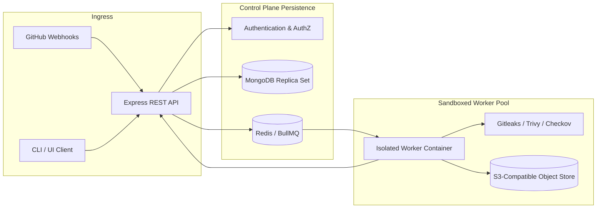
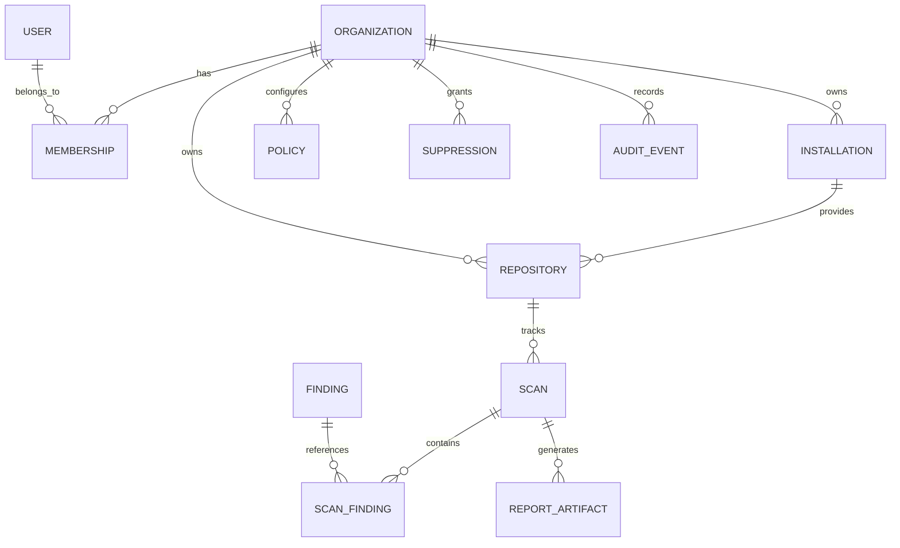
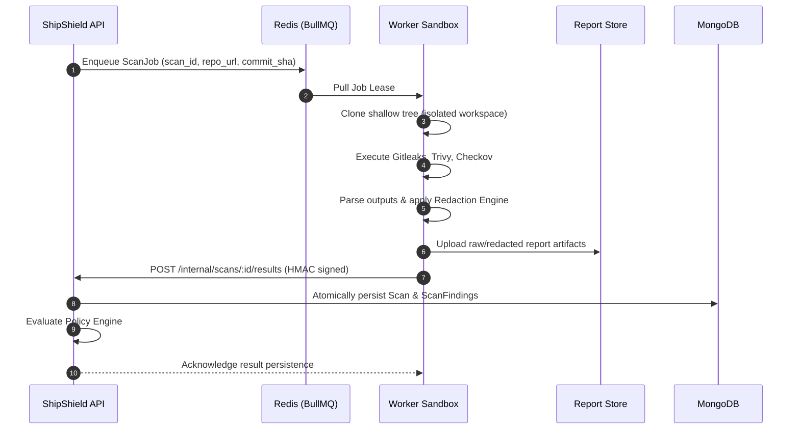
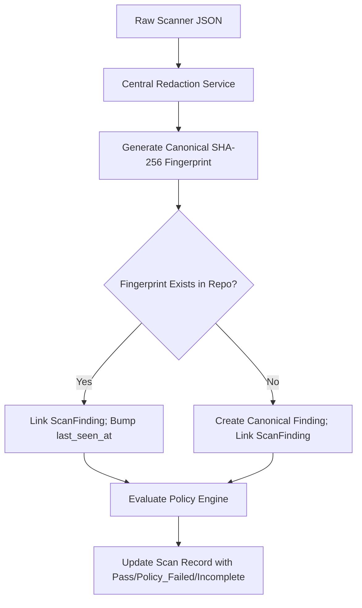

# 06 — Data Model and API Specification

**Document status:** Production Baseline Specification  
**Version:** 1.0  
**Product:** ShipShield  
**Audience:** Backend Engineers, Security Engineers, Platform Architects, Database Administrators  
**Normative Language:** **MUST**, **MUST NOT**, **SHOULD**, **SHOULD NOT**, and **MAY** reflect strict implementation requirements.

---

## 1. Executive Summary and System Context

This specification defines the authoritative database schemas, data isolation models, idempotency safeguards, and REST API contracts for the ShipShield control plane. ShipShield operates under a dual-execution architecture: a standalone local CLI and a hosted, multi-tenant collaboration platform backed by MongoDB and an asynchronous Redis/BullMQ worker pipeline.



The control plane coordinates user sessions, GitHub installations, repository access, scan orchestration, normalized security findings, blocking policies, and audit trails. It does **not** execute security scanners inside HTTP request handlers.

### Invariants Governing This Specification
1. **Tenant Isolation:** Every operational query and mutation **MUST** be explicitly scoped by an authorized `organization_id`. The API layer **MUST NOT** accept client-supplied ownership or bypass authorization filters.
2. **Zero Plaintext Secrets:** Plaintext credentials discovered during scans **MUST NOT** be persisted to the database, logs, or error payloads. The evidence block stores only structured, redacted context.
3. **Idempotency & Replay Protection:** Webhook deliveries and API-triggered scans **MUST** be idempotent, using cryptographic validation and deterministic deduplication keys.
4. **Normalized Finding Identity:** Finding identity across scans relies on deterministic, SHA-256 fingerprints rather than ephemeral database surrogate keys.

---

## 2. Global Data Conventions

To reconcile conventions across CLI outputs, JSON reports, and database persistence:

* **Database & Wire Format:** All MongoDB collection attributes, embedded documents, and external JSON payloads use strictly validated `snake_case`.
* **Primary Keys:** The primary internal identifier for all collections is a native MongoDB `ObjectId`, serialized as a 24-character hexadecimal string over HTTP APIs (`_id` or `id`).
* **External Identifiers:** Human-readable finding identifiers follow the format `SS-<CATEGORY_SHORT>-<CUID2/NANOID>` (e.g., `SS-SEC-9X2M1A`).
* **Timestamps:** All dates and timestamps are stored as native BSON `Date` objects (UTC) and serialized over API interfaces in ISO 8601 extended format: `YYYY-MM-DDTHH:mm:ss.sssZ`.
* **Durations:** Scanner and job execution durations are stored as non-negative integers representing milliseconds (`duration_ms`).
* **Enum Integrity:** All enumeration types are strictly enforced at both the database schema layer and API runtime validators (Zod).

---

## 3. MongoDB Data Architecture & Entity Schemas

### 3.1 Entity Relationship Model



---

### 3.2 Collection: `organizations`

Defines the security and billing boundary (tenant).

```javascript
{
  _id: ObjectId("6650a1b2c3d4e5f6a7b8c901"),
  name: "Acme Cybernetics",
  slug: "acme-cybernetics",
  billing_tier: "enterprise", // "free" | "team" | "enterprise"
  settings: {
    enforce_org_policy: true,
    max_concurrent_scans: 8,
    data_retention_days: 90,
    allowed_ip_cidrs: ["198.51.100.0/24"]
  },
  created_at: ISODate("2026-03-01T10:00:00.000Z"),
  updated_at: ISODate("2026-03-01T10:00:00.000Z")
}
```

**Indexes:**
* `{ slug: 1 }` (Unique)
* `{ created_at: -1 }`

---

### 3.3 Collection: `users`

Represents user identities authenticated via OAuth (GitHub) or session tokens.

```javascript
{
  _id: ObjectId("6650a1b2c3d4e5f6a7b8c902"),
  email: "secops@acme.com",
  full_name: "Alex Vance",
  avatar_url: "https://avatars.githubusercontent.com/u/1029384",
  auth_provider: "github", // "github" | "saml" | "local"
  auth_provider_id: "gh_1029384",
  status: "active", // "active" | "suspended" | "pending"
  created_at: ISODate("2026-03-01T10:15:00.000Z"),
  updated_at: ISODate("2026-03-01T10:15:00.000Z")
}
```

**Indexes:**
* `{ email: 1 }` (Unique)
* `{ auth_provider: 1, auth_provider_id: 1 }` (Unique)

---

### 3.4 Collection: `memberships`

Defines authorization scope and Role-Based Access Control (RBAC).

```javascript
{
  _id: ObjectId("6650a1b2c3d4e5f6a7b8c903"),
  organization_id: ObjectId("6650a1b2c3d4e5f6a7b8c901"),
  user_id: ObjectId("6650a1b2c3d4e5f6a7b8c902"),
  role: "admin", // "owner" | "admin" | "security_engineer" | "developer" | "viewer"
  status: "active", // "active" | "invited" | "revoked"
  created_at: ISODate("2026-03-01T10:20:00.000Z"),
  updated_at: ISODate("2026-03-01T10:20:00.000Z")
}
```

**Indexes:**
* `{ organization_id: 1, user_id: 1 }` (Unique)
* `{ user_id: 1, status: 1 }`

---

### 3.5 Collection: `installations`

Metadata for authorized GitHub App installations.

```javascript
{
  _id: ObjectId("6650a1b2c3d4e5f6a7b8c904"),
  organization_id: ObjectId("6650a1b2c3d4e5f6a7b8c901"),
  provider: "github",
  provider_installation_id: 48920192,
  account_name: "acme-cybernetics",
  account_type: "Organization", // "User" | "Organization"
  permissions: {
    contents: "read",
    checks: "write",
    pull_requests: "write",
    metadata: "read"
  },
  status: "active", // "active" | "suspended" | "deleted"
  suspended_at: null,
  created_at: ISODate("2026-03-01T11:00:00.000Z"),
  updated_at: ISODate("2026-03-01T11:00:00.000Z")
}
```

**Indexes:**
* `{ provider_installation_id: 1 }` (Unique)
* `{ organization_id: 1, status: 1 }`

---

### 3.6 Collection: `repositories`

Registered code repositories managed by ShipShield.

```javascript
{
  _id: ObjectId("6650a1b2c3d4e5f6a7b8c905"),
  organization_id: ObjectId("6650a1b2c3d4e5f6a7b8c901"),
  installation_id: ObjectId("6650a1b2c3d4e5f6a7b8c904"),
  provider_repo_id: 92837401,
  name: "payment-gateway",
  full_name: "acme-cybernetics/payment-gateway",
  default_branch: "main",
  private: true,
  clone_url: "https://github.com/acme-cybernetics/payment-gateway.git",
  scan_settings: {
    enabled_scanners: ["secrets", "dependencies", "containers", "iac"],
    fail_on: ["critical", "high"],
    fail_on_incomplete: true,
    scan_on_push: false,
    scan_on_pr: true
  },
  active: true,
  created_at: ISODate("2026-03-01T11:05:00.000Z"),
  updated_at: ISODate("2026-03-01T11:05:00.000Z")
}
```

**Indexes:**
* `{ provider_repo_id: 1 }` (Unique)
* `{ organization_id: 1, full_name: 1 }` (Unique)
* `{ organization_id: 1, active: 1 }`

---

### 3.7 Collection: `scans`

Represents an immutable execution snapshot against a specific commit SHA.

```javascript
{
  _id: ObjectId("6650a1b2c3d4e5f6a7b8c906"),
  scan_id: "scan_01JEXAMPLE0000000000000000", // KSUID / ULID
  organization_id: ObjectId("6650a1b2c3d4e5f6a7b8c901"),
  repository_id: ObjectId("6650a1b2c3d4e5f6a7b8c905"),
  trigger: "pull_request", // "manual" | "cli" | "push" | "pull_request" | "schedule"
  trigger_metadata: {
    actor_id: ObjectId("6650a1b2c3d4e5f6a7b8c902"),
    pull_request_number: 142,
    base_ref: "main",
    head_ref: "feat/pci-dss-compliance"
  },
  commit: {
    sha: "0123456789abcdef0123456789abcdef01234567",
    branch: "feat/pci-dss-compliance",
    author_name: "Alex Vance",
    author_email: "secops@acme.com",
    message: "Implement tokenization layer"
  },
  scope: {
    kind: "full", // "full" | "changed"
    base_sha: "9876543210fedcba9876543210fedcba98765432"
  },
  execution_status: "completed", // "queued" | "running" | "completed" | "failed" | "timed_out" | "cancelled"
  policy_outcome: "policy_failed", // "pending" | "passed" | "policy_failed" | "incomplete" | "error"
  scanners: [
    {
      id: "secrets",
      engine: "gitleaks",
      engine_version: "8.18.2",
      status: "completed", // "completed" | "not_applicable" | "disabled" | "skipped" | "failed" | "timed_out"
      duration_ms: 1240,
      finding_count: 1,
      error_message: null
    },
    {
      id: "dependencies",
      engine: "trivy",
      engine_version: "0.50.1",
      status: "completed",
      duration_ms: 4120,
      finding_count: 2,
      error_message: null
    },
    {
      id: "containers",
      engine: "trivy",
      engine_version: "0.50.1",
      status: "completed",
      duration_ms: 2200,
      finding_count: 1,
      error_message: null
    },
    {
      id: "iac",
      engine: "checkov",
      engine_version: "3.2.0",
      status: "completed",
      duration_ms: 6810,
      finding_count: 0,
      error_message: null
    }
  ],
  summary: {
    total_findings: 4,
    by_severity: {
      critical: 1,
      high: 1,
      medium: 2,
      low: 0,
      info: 0
    },
    policy_violations: 2
  },
  policy_decision: {
    evaluated_at: ISODate("2026-03-01T12:00:15.000Z"),
    rules_evaluated: 4,
    passed: false,
    violations: [
      {
        rule_id: "block-critical",
        finding_fingerprint: "sha256:e3b0c44298fc1c149afbf4c8996fb92427ae41e4649b934ca495991b7852b855",
        reason: "Critical finding violates zero-tolerance threshold"
      }
    ]
  },
  duration_ms: 14370,
  started_at: ISODate("2026-03-01T12:00:00.000Z"),
  completed_at: ISODate("2026-03-01T12:00:15.000Z"),
  created_at: ISODate("2026-03-01T11:59:58.000Z")
}
```

**Indexes:**
* `{ scan_id: 1 }` (Unique)
* `{ organization_id: 1, repository_id: 1, created_at: -1 }`
* `{ repository_id: 1, "commit.sha": 1 }`
* `{ organization_id: 1, execution_status: 1 }`

---

### 3.8 Collection: `findings`

Canonical tracking records for unique security issues across an organization.

```javascript
{
  _id: ObjectId("6650a1b2c3d4e5f6a7b8c907"),
  organization_id: ObjectId("6650a1b2c3d4e5f6a7b8c901"),
  repository_id: ObjectId("6650a1b2c3d4e5f6a7b8c905"),
  fingerprint: "sha256:e3b0c44298fc1c149afbf4c8996fb92427ae41e4649b934ca495991b7852b855",
  public_id: "SS-SEC-7K2M",
  type: "secret.exposed_credential",
  category: "secrets", // "secrets" | "dependencies" | "containers" | "iac"
  scanner: "gitleaks",
  rule_id: "generic-api-key",
  title: "Potential exposed credential",
  description: "A sensitive private token pattern was committed.",
  severity_normalized: "critical", // "critical" | "high" | "medium" | "low" | "info"
  severity_original: "CRITICAL",
  confidence: "high", // "high" | "medium" | "low"
  current_location: {
    path: "config/example.env",
    start_line: 12,
    end_line: 12
  },
  lifecycle_status: "open", // "open" | "fixed" | "suppressed" | "accepted_risk"
  first_detected_scan_id: ObjectId("6650a1b2c3d4e5f6a7b8c906"),
  last_detected_scan_id: ObjectId("6650a1b2c3d4e5f6a7b8c906"),
  resolved_scan_id: null,
  active_suppression_id: null,
  first_seen_at: ISODate("2026-03-01T12:00:15.000Z"),
  last_seen_at: ISODate("2026-03-01T12:00:15.000Z"),
  created_at: ISODate("2026-03-01T12:00:15.000Z"),
  updated_at: ISODate("2026-03-01T12:00:15.000Z")
}
```

**Indexes:**
* `{ organization_id: 1, repository_id: 1, fingerprint: 1 }` (Unique)
* `{ organization_id: 1, lifecycle_status: 1, severity_normalized: 1 }`
* `{ repository_id: 1, lifecycle_status: 1 }`
* `{ public_id: 1 }` (Unique)

---

### 3.9 Collection: `scan_findings`

M:N link table capturing finding instances for an exact scan revision.

```javascript
{
  _id: ObjectId("6650a1b2c3d4e5f6a7b8c908"),
  organization_id: ObjectId("6650a1b2c3d4e5f6a7b8c901"),
  scan_id: ObjectId("6650a1b2c3d4e5f6a7b8c906"),
  finding_id: ObjectId("6650a1b2c3d4e5f6a7b8c907"),
  fingerprint: "sha256:e3b0c44298fc1c149afbf4c8996fb92427ae41e4649b934ca495991b7852b855",
  location: {
    path: "config/example.env",
    start_line: 12,
    end_line: 12
  },
  evidence: {
    redacted: true,
    summary: "Credential pattern detected: KEY=****************",
    line_snippet: "API_SECRET=****"
  },
  remediation: {
    summary: "Revoke or rotate the credential immediately; remove from git history.",
    fix_available: false,
    fix_strategy: null
  },
  occurrence_status: "new", // "new" | "existing" | "fixed" | "suppressed"
  created_at: ISODate("2026-03-01T12:00:15.000Z")
}
```

**Indexes:**
* `{ scan_id: 1, finding_id: 1 }` (Unique)
* `{ organization_id: 1, scan_id: 1, occurrence_status: 1 }`
* `{ finding_id: 1, created_at: -1 }`

---

### 3.10 Collection: `policies`

Enforceable rules evaluated on scan completion.

```javascript
{
  _id: ObjectId("6650a1b2c3d4e5f6a7b8c909"),
  organization_id: ObjectId("6650a1b2c3d4e5f6a7b8c901"),
  repository_id: null, // Null indicates organization-wide baseline
  name: "Default Deployment Gate",
  description: "Strict blocking on Critical and High risks; fail on incomplete coverage",
  rules: {
    fail_on_severities: ["critical", "high"],
    fail_on_incomplete: true,
    block_on_unresolved_secrets: true,
    allowed_dependency_licenses: ["MIT", "Apache-2.0", "BSD-3-Clause"]
  },
  enforced: true,
  version: 1,
  created_by: ObjectId("6650a1b2c3d4e5f6a7b8c902"),
  created_at: ISODate("2026-03-01T10:00:00.000Z"),
  updated_at: ISODate("2026-03-01T10:00:00.000Z")
}
```

**Indexes:**
* `{ organization_id: 1, repository_id: 1 }`
* `{ organization_id: 1, enforced: 1 }`

---

### 3.11 Collection: `suppressions`

Audit-controlled, time-bounded risk acceptances.

```javascript
{
  _id: ObjectId("6650a1b2c3d4e5f6a7b8c90a"),
  organization_id: ObjectId("6650a1b2c3d4e5f6a7b8c901"),
  repository_id: ObjectId("6650a1b2c3d4e5f6a7b8c905"),
  finding_fingerprint: "sha256:e3b0c44298fc1c149afbf4c8996fb92427ae41e4649b934ca495991b7852b855",
  scope: "single_finding", // "single_finding" | "rule" | "repository"
  rule_id: "generic-api-key",
  justification: "Test credential committed to documentation fixture. Value is deactivated.",
  approved_by: ObjectId("6650a1b2c3d4e5f6a7b8c902"),
  status: "active", // "active" | "expired" | "revoked"
  expires_at: ISODate("2026-06-01T00:00:00.000Z"),
  created_at: ISODate("2026-03-01T13:00:00.000Z"),
  updated_at: ISODate("2026-03-01T13:00:00.000Z")
}
```

**Indexes:**
* `{ organization_id: 1, finding_fingerprint: 1, status: 1 }`
* `{ expires_at: 1 }, { expireAfterSeconds: 0 }` (Automated TTL expiration)

---

### 3.12 Collection: `audit_events`

Immutable chronological log of all security, policy, and configuration actions.

```javascript
{
  _id: ObjectId("6650a1b2c3d4e5f6a7b8c90b"),
  organization_id: ObjectId("6650a1b2c3d4e5f6a7b8c901"),
  actor: {
    actor_id: ObjectId("6650a1b2c3d4e5f6a7b8c902"),
    type: "user", // "user" | "system" | "github_app"
    email: "secops@acme.com",
    ip_address: "198.51.100.42",
    user_agent: "Mozilla/5.0 (Macintosh; Intel Mac OS X 10_15_7)"
  },
  action: "suppression.created",
  target: {
    entity_type: "suppression",
    entity_id: ObjectId("6650a1b2c3d4e5f6a7b8c90a"),
    display_name: "SS-SEC-7K2M"
  },
  metadata: {
    justification: "Test fixture credential",
    expires_at: "2026-06-01T00:00:00.000Z"
  },
  created_at: ISODate("2026-03-01T13:00:00.000Z")
}
```

**Indexes:**
* `{ organization_id: 1, created_at: -1 }`
* `{ "actor.actor_id": 1, created_at: -1 }`
* `{ "target.entity_type": 1, "target.entity_id": 1 }`

---

### 3.13 Collection: `webhook_events`

Enforces idempotency and provides an audit log for incoming third-party webhooks.

```javascript
{
  _id: ObjectId("6650a1b2c3d4e5f6a7b8c90c"),
  provider: "github",
  delivery_id: "72d3162e-ccb8-11ee-823a-18b6e22e8efc",
  event_type: "pull_request",
  installation_id: 48920192,
  status: "processed", // "received" | "processing" | "processed" | "failed" | "ignored"
  error_message: null,
  received_at: ISODate("2026-03-01T11:59:50.000Z"),
  processed_at: ISODate("2026-03-01T11:59:52.000Z")
}
```

**Indexes:**
* `{ provider: 1, delivery_id: 1 }` (Unique)
* `{ received_at: 1 }, { expireAfterSeconds: 604800 }` (7-day TTL retention)

---

## 4. API Architecture & Standard Protocols

### 4.1 Base Conventions
* **Base URL:** `/api/v1`
* **Transport:** HTTPS strictly required with TLS 1.3 preferred.
* **Content Negotiation:** All request bodies and response payloads use `application/json; charset=utf-8`.
* **CORS:** Restricted strictly to authorized web dashboard origins; credentials allowed.

### 4.2 Standard Headers

#### Request Headers
* `Authorization: Bearer <JWT_ACCESS_TOKEN>`
* `X-Request-Id: <UUIDv4>` (Client-propagated or edge-injected)
* `X-ShipShield-Client: cli/0.1.0` (Client identification)

#### Response Headers
* `X-Request-Id: <UUIDv4>`
* `X-Content-Type-Options: nosniff`
* `Strict-Transport-Security: max-age=63072000; includeSubDomains; preload`
* `Content-Security-Policy: default-src 'none'`

---

### 4.3 Error Contract

Every HTTP non-2xx response returns a predictable, RFC 7807-inspired JSON structure:

```json
{
  "error": {
    "code": "RESOURCE_NOT_FOUND",
    "message": "The requested repository could not be located.",
    "request_id": "72d3162e-ccb8-11ee-823a-18b6e22e8efc",
    "timestamp": "2026-03-01T12:00:00.000Z",
    "details": [
      {
        "field": "id",
        "issue": "No repository matching the provided ID exists within your organization."
      }
    ]
  }
}
```

#### Canonical Error Code Mapping

| Status Code | Error Code (`code`) | Meaning |
|---|---|---|
| `400` | `INVALID_ARGUMENT` | Payload validation failure or malformed JSON syntax. |
| `401` | `UNAUTHENTICATED` | Bearer token missing, invalid, or expired. |
| `403` | `PERMISSION_DENIED` | Authenticated actor lacks privilege for this tenant/resource. |
| `404` | `RESOURCE_NOT_FOUND` | Target entity does not exist within the tenant boundary. |
| `409` | `RESOURCE_CONFLICT` | Unique key violation or state collision. |
| `422` | `POLICY_VIOLATION` | Business logic or security policy rejected the action. |
| `429` | `RATE_LIMITED` | Tenant or IP exceeded concurrency or request allocations. |
| `500` | `INTERNAL_ERROR` | Unhandled runtime failure; sanitized diagnostics emitted. |

---

### 4.4 Pagination, Sorting, and Filtering

List endpoints handle pagination via limit/offset parameters:

```text
GET /api/v1/scans?limit=25&offset=50&sort=-created_at&status=completed
```

#### Response Envelope
```json
{
  "data": [ ],
  "pagination": {
    "total_records": 124,
    "limit": 25,
    "offset": 50,
    "has_more": true
  }
}
```

---

## 5. Exhaustive REST API Specification

### 5.1 Authentication & Health

#### `GET /api/v1/health/live`
Determines if the process is up.
* **Auth:** None
* **Status:** `200 OK`
```json
{
  "status": "pass"
}
```

#### `GET /api/v1/health/ready`
Determines if dependent databases and queues are responsive.
* **Auth:** None
* **Status:** `200 OK`
```json
{
  "status": "pass",
  "checks": {
    "mongodb": "healthy",
    "redis": "healthy"
  }
}
```

---

### 5.2 Organizations & Repositories

#### `GET /api/v1/organizations`
List authorized organizations for the current user.
* **Auth:** Bearer Token
* **Status:** `200 OK`
```json
{
  "data": [
    {
      "id": "6650a1b2c3d4e5f6a7b8c901",
      "name": "Acme Cybernetics",
      "slug": "acme-cybernetics",
      "role": "admin",
      "created_at": "2026-03-01T10:00:00.000Z"
    }
  ]
}
```

#### `GET /api/v1/repositories`
List registered repositories within the organization.
* **Auth:** Bearer Token
* **Query Params:** `org_id` (required), `limit`, `offset`, `search`
* **Status:** `200 OK`
```json
{
  "data": [
    {
      "id": "6650a1b2c3d4e5f6a7b8c905",
      "name": "payment-gateway",
      "full_name": "acme-cybernetics/payment-gateway",
      "default_branch": "main",
      "private": true,
      "scan_settings": {
        "enabled_scanners": ["secrets", "dependencies", "containers", "iac"],
        "fail_on": ["critical", "high"]
      },
      "created_at": "2026-03-01T11:05:00.000Z"
    }
  ],
  "pagination": { "total_records": 1, "limit": 25, "offset": 0, "has_more": false }
}
```

#### `POST /api/v1/repositories/connect`
Explicitly connect an available repository from an active GitHub App installation.
* **Auth:** Bearer Token (Roles: `owner`, `admin`)
* **Request:**
```json
{
  "org_id": "6650a1b2c3d4e5f6a7b8c901",
  "provider_repo_id": 92837401,
  "scan_settings": {
    "enabled_scanners": ["secrets", "dependencies", "containers", "iac"],
    "fail_on": ["critical", "high"],
    "fail_on_incomplete": true
  }
}
```
* **Status:** `201 Created`

---

### 5.3 Scan Execution & Findings Management

#### `POST /api/v1/repositories/:id/scans`
Manually trigger or register a scan execution.
* **Auth:** Bearer Token
* **Request:**
```json
{
  "commit_sha": "0123456789abcdef0123456789abcdef01234567",
  "branch": "feat/pci-dss-compliance",
  "scope": "full"
}
```
* **Status:** `202 Accepted`
```json
{
  "scan_id": "scan_01JEXAMPLE0000000000000000",
  "status": "queued",
  "created_at": "2026-03-01T12:00:00.000Z"
}
```

#### `GET /api/v1/scans/:id`
Retrieve execution metadata and summary status for a scan.
* **Auth:** Bearer Token
* **Status:** `200 OK`
```json
{
  "scan_id": "scan_01JEXAMPLE0000000000000000",
  "repository_id": "6650a1b2c3d4e5f6a7b8c905",
  "commit": {
    "sha": "0123456789abcdef0123456789abcdef01234567",
    "branch": "feat/pci-dss-compliance"
  },
  "execution_status": "completed",
  "policy_outcome": "policy_failed",
  "scanners": [
    {
      "id": "secrets",
      "status": "completed",
      "engine": "gitleaks",
      "duration_ms": 1240,
      "finding_count": 1
    }
  ],
  "summary": {
    "total_findings": 1,
    "by_severity": { "critical": 1, "high": 0, "medium": 0, "low": 0, "info": 0 },
    "policy_violations": 1
  },
  "duration_ms": 14370,
  "completed_at": "2026-03-01T12:00:15.000Z"
}
```

#### `GET /api/v1/scans/:id/findings`
Retrieve normalized findings associated with a scan revision.
* **Auth:** Bearer Token
* **Query Params:** `severity`, `scanner`, `limit`, `offset`
* **Status:** `200 OK`
```json
{
  "data": [
    {
      "id": "SS-SEC-7K2M",
      "fingerprint": "sha256:e3b0c44298fc1c149afbf4c8996fb92427ae41e4649b934ca495991b7852b855",
      "type": "secret.exposed_credential",
      "title": "Potential exposed credential",
      "severity": "critical",
      "scanner": "secrets",
      "location": {
        "path": "config/example.env",
        "start_line": 12,
        "end_line": 12
      },
      "evidence": {
        "redacted": true,
        "summary": "Credential pattern detected: KEY=****************"
      },
      "remediation": {
        "summary": "Revoke or rotate the credential immediately.",
        "fix_available": false
      },
      "occurrence_status": "new"
    }
  ],
  "pagination": { "total_records": 1, "limit": 25, "offset": 0, "has_more": false }
}
```

#### `PATCH /api/v1/findings/:id/status`
Update finding lifecycle state (e.g., manual risk acceptance or state override).
* **Auth:** Bearer Token (Roles: `owner`, `admin`, `security_engineer`)
* **Request:**
```json
{
  "status": "accepted_risk",
  "justification": "Credential rotated; waiting on deployment cache invalidation."
}
```
* **Status:** `200 OK`
```json
{
  "id": "SS-SEC-7K2M",
  "lifecycle_status": "accepted_risk",
  "updated_at": "2026-03-01T13:30:00.000Z"
}
```

---

### 5.4 Policy & Suppressions Management

#### `GET /api/v1/policies`
List organizational policies.
* **Auth:** Bearer Token
* **Query Params:** `org_id` (required)
* **Status:** `200 OK`

#### `PUT /api/v1/policies/:id`
Update an enforceable security policy.
* **Auth:** Bearer Token (Roles: `owner`, `admin`)
* **Request:**
```json
{
  "rules": {
    "fail_on_severities": ["critical", "high", "medium"],
    "fail_on_incomplete": true,
    "block_on_unresolved_secrets": true
  }
}
```
* **Status:** `200 OK`

#### `POST /api/v1/suppressions`
Create a time-bounded suppression.
* **Auth:** Bearer Token (Roles: `owner`, `admin`, `security_engineer`)
* **Request:**
```json
{
  "org_id": "6650a1b2c3d4e5f6a7b8c901",
  "finding_fingerprint": "sha256:e3b0c44298fc1c149afbf4c8996fb92427ae41e4649b934ca495991b7852b855",
  "scope": "single_finding",
  "justification": "Synthetic credential committed to test mock repository.",
  "expires_at": "2026-06-01T00:00:00.000Z"
}
```
* **Status:** `201 Created`

---

### 5.5 GitHub Webhook Integration

#### `POST /api/v1/webhooks/github`
Ingress endpoint for GitHub App webhook events.
* **Auth:** HMAC-SHA256 Signature Verification via `X-Hub-Signature-256` header.
* **Payload:** Native GitHub Webhook Event Payload (e.g., `pull_request`, `push`, `installation`).
* **Response Status Codes:**
  * `200 OK`: Delivery acknowledged, signature valid, job successfully enqueued or ignored.
  * `400 Bad Request`: Missing delivery headers or malformed payload.
  * `401 Unauthorized`: HMAC signature mismatch.

---

## 6. Worker Execution Architecture & Data Contracts

Scanning untrusted source code requires strict separation between the control plane and workers.



### 6.1 BullMQ Job Payload (`scan_jobs` queue)
```json
{
  "scan_id": "scan_01JEXAMPLE0000000000000000",
  "organization_id": "6650a1b2c3d4e5f6a7b8c901",
  "repository_id": "6650a1b2c3d4e5f6a7b8c905",
  "commit_sha": "0123456789abcdef0123456789abcdef01234567",
  "scope": "full",
  "scanners": ["secrets", "dependencies", "containers", "iac"],
  "installation_id": 48920192,
  "enqueued_at": "2026-03-01T12:00:00.000Z"
}
```

### 6.2 Worker Internal Completion Ingress Contract

Workers report findings back to the control plane using an unexposed, mutually authenticated endpoint:

`POST /api/v1/internal/scans/:id/complete`

```json
{
  "execution_status": "completed",
  "scanners": [
    {
      "id": "secrets",
      "engine": "gitleaks",
      "engine_version": "8.18.2",
      "status": "completed",
      "duration_ms": 1240,
      "finding_count": 1,
      "error_message": null
    }
  ],
  "findings": [
    {
      "fingerprint": "sha256:e3b0c44298fc1c149afbf4c8996fb92427ae41e4649b934ca495991b7852b855",
      "type": "secret.exposed_credential",
      "category": "secrets",
      "scanner": "gitleaks",
      "rule_id": "generic-api-key",
      "title": "Potential exposed credential",
      "description": "Sensitive credential committed to source.",
      "severity_normalized": "critical",
      "severity_original": "CRITICAL",
      "confidence": "high",
      "location": {
        "path": "config/example.env",
        "start_line": 12,
        "end_line": 12
      },
      "evidence": {
        "redacted": true,
        "summary": "API_SECRET=****"
      },
      "remediation": {
        "summary": "Revoke credential immediately.",
        "fix_available": false
      }
    }
  ],
  "duration_ms": 14370
}
```

---

## 7. Data Ingestion, Deduplication, and Normalization Pipeline

When raw scan findings are received from either the CLI or worker processes, the ingestion service executes an atomic normalization transaction:



### Deterministic Fingerprint Calculation Rules

To prevent unstable line shifts from fragmenting findings across scans, fingerprints **MUST** be generated using the following category-specific input hashes:

* **Secrets:**  
  $$\text{SHA256}(\text{"secret"} \parallel \text{rule\_id} \parallel \text{canonical\_relative\_path} \parallel \text{structural\_context})$$  
  *(Note: The actual secret value is NEVER fed to the hash algorithm without a secure keyed HMAC).*
* **Dependencies:**  
  $$\text{SHA256}(\text{"dependency"} \parallel \text{package\_name} \parallel \text{installed\_version} \parallel \text{advisory\_id})$$
* **Containers:**  
  $$\text{SHA256}(\text{"container"} \parallel \text{canonical\_relative\_path} \parallel \text{dockerfile\_instruction} \parallel \text{rule\_id})$$
* **Infrastructure as Code (IaC):**  
  $$\text{SHA256}(\text{"iac"} \parallel \text{canonical\_relative\_path} \parallel \text{resource\_address} \parallel \text{rule\_id})$$

---

## 8. Webhook Processing & Security Safeguards

To prevent replay attacks, unauthorized execution, and resource exhaustion:

```javascript
// Verification implementation pattern
import crypto from "crypto";

export function verifyGitHubSignature(rawBody, signatureHeader, secret) {
  if (!signatureHeader || !signatureHeader.startsWith("sha256=")) {
    return false;
  }
  const signature = signatureHeader.substring(7);
  const hmac = crypto.createHmac("sha256", secret);
  const digest = hmac.update(rawBody).digest("hex");
  
  // Constant-time comparison prevents timing attacks
  return crypto.timingSafeEqual(Buffer.from(signature, "hex"), Buffer.from(digest, "hex"));
}
```

### Webhook Deduplication Algorithm
1. Extract `X-GitHub-Delivery` GUID from the HTTP headers.
2. Perform an atomic upsert on the `webhook_events` collection:
   ```javascript
   db.webhook_events.updateOne(
     { provider: "github", delivery_id: deliveryId },
     { 
       $setOnInsert: { 
         event_type: eventType, 
         installation_id: instId, 
         status: "received", 
         received_at: new Date() 
       } 
     },
     { upsert: true }
   );
   ```
3. If `matchedCount > 0`, the delivery is a duplicate. Immediately respond with `200 OK` and abort downstream job creation.
4. Validate that the repository and installation are active and mapped within an authorized organization.
5. Enqueue the scan job into BullMQ and update the event status to `processed`.

---

## 9. Security, Threat Surface, and Auditing Controls

### 9.1 Tenant Isolation Invariants
* Every database repository query **MUST** begin with the authenticated tenant identifier:  
  `{ organization_id: currentSession.orgId, ...query }`.
* Cross-tenant references (e.g., attempting to scan a `repository_id` belonging to an external organization) **MUST** return a generic `404 RESOURCE_NOT_FOUND` to prevent IDOR scanning and enumeration attacks.

### 9.2 Central Redaction Engine
Raw outputs from external scanners must be passed through a streaming regex redaction tokenizer before database storage or reporting.

The engine redacts:
* Generic high-entropy hex/base64 strings ($H > 4.5$).
* Common token signatures (`ghp_`, `glpat-`, `AKIA`, `ASIA`, `ey...`).
* Private key headers (`-----BEGIN [A-Z ]+ PRIVATE KEY-----`).

Violating records are flagged with `"evidence.redacted": true`.

### 9.3 Immutable Audit Logging
The following security-critical events automatically emit immutable entries into `audit_events`:
* User authentication and session revocation.
* Repository connection or removal.
* Policy creation, deletion, or rule modification.
* Suppression creation or premature revocation.
* Automated or manual remediation execution.
* Webhook signature failures and authentication anomalies.

---

## 10. Automated Database Lifecycle & Maintenance

### 10.1 Retention Cleanup (Automated MongoDB TTLs)
* **Webhook Receipts:** Managed via index on `webhook_events.received_at` with an expiry of 7 days (`604800` seconds).
* **Suppression Expirations:** Scheduled workers poll for documents where `status == "active"` and `expires_at < new Date()`, setting status to `"expired"` and emitting an audit event.
* **Scan Report Artifacts:** Configured per organization policy (default 90 days). S3 lifecycle policies delete report buckets, while MongoDB documents transition to an archived state.

### 10.2 Database Migration Framework
* Database schema changes are versioned and managed using programmatic migrations (e.g., `migrate-mongo`).
* Migrations **MUST** support forward-only schema transitions with backward-compatible reads during multi-replica rolling deployments.
* Field additions must supply deterministic schema defaults.

---

## 11. Implementation Verification Checklist

A release candidate cannot be verified as production-grade until these controls pass integration testing:

- [ ] **RBAC & Multi-Tenancy:** Tested across automated IDOR suites to ensure users from `Org A` cannot query, mutate, or deduce the existence of `Org B` resources.
- [ ] **Redaction Verification:** Fixture repositories with synthetic credentials confirmed to have 0% unredacted secret occurrences in MongoDB documents, S3 reports, and API responses.
- [ ] **Webhook Idempotency:** Duplicate deliveries of identical `delivery_id` payloads generate exactly one BullMQ scan job.
- [ ] **Fail-Closed Reporting:** Scanner worker timeouts, process crashes, and non-zero exit codes correctly record `incomplete` or `failed` statuses rather than silent passes.
- [ ] **TTL & Index Verification:** All defined compound indexes exist on the target cluster and query executions confirm index-covered collection scans.
- [ ] **Contract Integrity:** REST API endpoints validated against TypeScript and Zod contract test suites, returning RFC-compliant error payloads on malformed input.