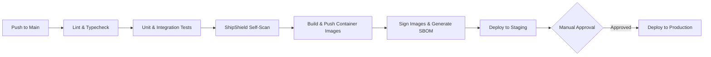

# 09 — DevOps and Deployment Guide

**Document status:** Production Baseline Specification  
**Version:** 1.0  
**Product:** ShipShield  
**Audience:** DevOps Engineers, Site Reliability Engineers (SRE), Backend Engineers, Security Engineers  
**Normative Language:** **MUST**, **MUST NOT**, **SHOULD**, **SHOULD NOT**, and **MAY** represent strict infrastructure and operational requirements.

---

## 1. Executive Summary & DevOps Principles

This specification defines the infrastructure, deployment topologies, continuous integration, and continuous delivery (CI/CD) practices for the ShipShield platform. 

Because ShipShield processes untrusted source code and sensitive security findings, its deployment architecture **MUST** prioritize strict network isolation, least-privilege identity access management (IAM), and ephemeral worker execution environments.

### Core Operational Principles
1. **Infrastructure as Code (IaC):** All production, staging, and CI infrastructure **MUST** be defined in Terraform. Manual resource creation in cloud consoles is strictly prohibited.
2. **Immutable Artifacts:** Container images are built, scanned, and signed once. The exact same image digest progresses through Staging to Production.
3. **Worker Isolation:** Scan workers **MUST** execute in private subnets with no inbound ingress, restricted outbound egress, and no access to control-plane administrative credentials.
4. **Dogfooding:** ShipShield's CI/CD pipeline **MUST** utilize the ShipShield CLI to scan its own source code, dependencies, Dockerfiles, and Terraform configurations before any merge or release.

---

## 2. Local Development Environment

To ensure development parity with production, engineers run the ShipShield stack locally using Docker Compose.

### 2.1 Services Topology
* **API Service:** Node.js Express server (hot-reloading enabled).
* **Worker Service:** Node.js BullMQ worker (executes scanners).
* **Web UI:** React/Vite frontend.
* **MongoDB:** Local replica set (required for transactions).
* **Redis:** Ephemeral queue state.

### 2.2 Standard `docker-compose.yml` (Abridged)
```yaml
version: '3.8'

services:
  api:
    build:
      context: .
      target: development
    ports:
      - "3000:3000"
    environment:
      - NODE_ENV=development
      - MONGODB_URI=mongodb://mongo:27017/shipshield?replicaSet=rs0
      - REDIS_URL=redis://redis:6379
      - JWT_SECRET=local-dev-secret-do-not-use-in-prod
    depends_on:
      mongo:
        condition: service_healthy
      redis:
        condition: service_healthy

  worker:
    build:
      context: .
      target: worker-development
    environment:
      - NODE_ENV=development
      - REDIS_URL=redis://redis:6379
      # Workers do not get MONGODB_URI in production, but do in local dev for simplified testing
    depends_on:
      - redis

  mongo:
    image: mongo:7.0
    command: ["--replSet", "rs0", "--bind_ip_all"]
    ports:
      - "27017:27017"
    healthcheck:
      test: echo "try { rs.status() } catch (err) { rs.initiate() }" | mongosh --port 27017 --quiet
      interval: 5s
      timeout: 5s
      retries: 5

  redis:
    image: redis:7.2-alpine
    ports:
      - "6379:6379"
    healthcheck:
      test: ["CMD", "redis-cli", "ping"]
      interval: 5s
      timeout: 3s
      retries: 5
```

---

## 3. CI/CD Pipeline Architecture

The CI/CD pipeline is implemented via GitHub Actions. It enforces strict quality gates, generates Software Bills of Materials (SBOMs), and signs container images using Sigstore/Cosign.



### 3.1 Required Pipeline Jobs
1. **Static Analysis & Testing:** Executes ESLint, TypeScript compilation, Vitest suites, and checks coverage thresholds (defined in `08-testing-strategy-and-quality-gates.md`).
2. **Security Scan (Dogfooding):** Executes the `shipshield plan` CLI command against the repository. **MUST** fail the build if `policy_failed` is returned.
3. **Container Build:** Uses Docker Buildx for multi-architecture builds (amd64/arm64).
4. **Image Signing:** Cryptographically signs the immutable container digest.

---

## 4. Infrastructure as Code (Terraform)

Cloud infrastructure is provisioned via Terraform, adhering to a modular and layered structure.

### 4.1 Repository Layout
```text
infra/terraform/
├── modules/
│   ├── network/          # VPC, Subnets, NAT Gateways
│   ├── database/         # Managed MongoDB (DocumentDB/Atlas), ElastiCache
│   ├── compute/          # ECS/EKS Clusters, Fargate Profiles
│   └── iam/              # Least-privilege execution roles
├── environments/
│   ├── staging/
│   │   └── main.tf
│   └── production/
│       └── main.tf
└── backend.tf            # Remote state (S3 + DynamoDB locking)
```

### 4.2 Infrastructure Security Invariants
* **Private Networking:** MongoDB and Redis instances **MUST** be deployed in isolated private subnets. They **MUST NOT** possess public IP addresses.
* **NAT Egress:** Scan workers reside in private subnets and route outbound traffic through a NAT Gateway.
* **Worker IAM Roles:** Worker compute instances/containers **MUST NOT** possess IAM permissions to modify cloud infrastructure, access KMS keys used by the control plane, or read/write to unrelated S3 buckets.

---

## 5. Production Deployment Topology

ShipShield utilizes a managed container orchestration platform (e.g., AWS ECS Fargate or Google Cloud Run / GKE) to minimize operational overhead for the control plane, while tightly sandboxing the worker pool.

```mermaid
flowchart TB
    subgraph Public Cloud
        ALB[Application Load Balancer]
        
        subgraph Control Plane VPC
            API[API Service Replicas]
            Web[Web UI (CDN/Static)]
            
            ALB --> API
            Web --> API
        end

        subgraph Data Plane VPC (Private)
            DB[(Managed MongoDB)]
            Redis[(Managed Redis)]
            
            API --> DB
            API --> Redis
        end

        subgraph Worker VPC (Sandboxed)
            WorkerPool[Worker Containers (Fargate/GKE)]
            
            Redis <-- "Pulls Jobs" --> WorkerPool
            WorkerPool -- "Pushes Reports" --> S3[(Report S3 Bucket)]
            WorkerPool -- "API Callback" --> API
        end
    end
```

### 5.1 The Worker Sandbox
Workers execute untrusted source code and third-party binaries. 
* **Compute:** Ephemeral, serverless containers (e.g., AWS Fargate).
* **Lifecycle:** One job per container lifecycle is preferred to prevent cross-scan contamination, or a strict workspace teardown script **MUST** run between jobs.
* **Privileges:** `securityContext.privileged = false`, `readOnlyRootFilesystem = true` (except for `/tmp` workspace), `runAsNonRoot = true`.

---

## 6. Secrets Management

* **No Hardcoded Secrets:** Credentials, API keys, and JWT secrets **MUST NOT** exist in plaintext within Terraform state, source code, or CI variables.
* **Secret Injection:** The platform **MUST** use a managed secrets provider (AWS Secrets Manager, HashiCorp Vault, or GCP Secret Manager).
* **GitHub App Keys:** The GitHub App private key is highly sensitive. It **MUST** be injected into the API service at runtime via the secret manager and rotated every 90 days.

---

## 7. Observability, Logging, and Metrics

### 7.1 Structured Logging
All services **MUST** emit JSON-formatted logs to standard output (`stdout`).

```json
{
  "timestamp": "2026-10-24T12:00:00Z",
  "level": "info",
  "service": "shipshield-worker",
  "trace_id": "req-98765",
  "scan_id": "scan_01JEXAMPLE",
  "message": "Scanner trivy completed successfully",
  "duration_ms": 4120
}
```
* **CRITICAL INVARIANT:** Logs **MUST NEVER** contain raw secret values, access tokens, or unredacted scanner evidence blocks. Redaction occurs at the application boundary.

### 7.2 Core Metrics to Monitor
1. **API:** HTTP 5xx Error Rate, P95/P99 Request Latency.
2. **Queue (BullMQ):** Job Wait Time, Active Job Count, Failed Job Rate.
3. **Workers:** OOM (Out of Memory) Kills, CPU Utilization, Scanner Timeout Frequency.
4. **Security:** Count of `policy_failed` outcomes vs `passed` outcomes.

---

## 8. Backup, Retention, and Disaster Recovery

* **Database Backups:** Automated, encrypted snapshots of the MongoDB cluster **MUST** occur daily, with a retention period of 30 days. Point-in-Time Recovery (PITR) **SHOULD** be enabled.
* **Report Artifacts (S3):** S3 buckets storing JSON/Markdown reports **MUST** have lifecycle policies enabled.
    * Move to Infrequent Access (IA) after 30 days.
    * Permanently delete after 90 days (configurable per tenant).
* **Disaster Recovery (DR):** The IaC setup **MUST** allow the entire stateless infrastructure (API, Workers, Load Balancers) to be recreated in a secondary region within 1 hour (RTO < 1h).

---

## 9. Release Engineering & Rollbacks

### 9.1 Versioning
ShipShield adheres strictly to Semantic Versioning (SemVer 2.0.0).
* API and CLI versions are tagged in Git (e.g., `v1.2.0`).
* Container images are tagged with both the SemVer tag and the Git Commit SHA (e.g., `shipshield-api:v1.2.0-a1b2c3d`).

### 9.2 Zero-Downtime Deployments
* Deployments **MUST** utilize rolling updates.
* New API pods **MUST** pass health checks (`/api/v1/health/live` and `/api/v1/health/ready`) before the Load Balancer routes traffic to them.
* Database migrations **MUST** be forward-compatible to ensure old pods and new pods can operate concurrently during the rollout window.

### 9.3 Rollback Strategy
If the error rate exceeds 5% during a deployment, or if health checks fail, the deployment system (e.g., ECS Deployment Controller, ArgoCD) **MUST** automatically halt the rollout and revert to the previous container digest.